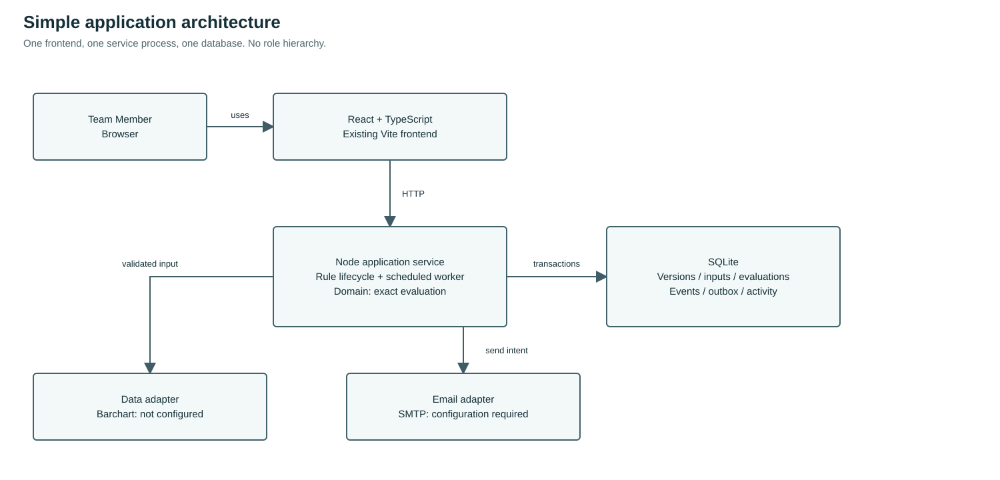

# HedgeSignal: Algorithmic Hedging Trigger and Alert System

## Project Report and Agile Development Plan

**Document ID:** HS-PRJ-001  
**Version:** 0.3  
**Date:** 10 November 2026  
**Owner:** Development team  
**Scope:** Internal shared team workspace, rule evaluation and email alerts.

## 1. Project background

The team needs a practical way to configure hedging conditions, examine their inputs, evaluate them consistently and inspect the evidence behind an alert. The immediate objective is to develop and try the algorithm with the existing team. An enterprise role hierarchy is unnecessary at this stage.

HedgeSignal is the working product name. This report explains delivery and design decisions. The companion SRS defines requirements, actors, use cases, data models, flowcharts and acceptance criteria. Version 0.3 supersedes the earlier multi-role proposal.

## 2. Problem statement

Manual monitoring requires repeated checking of input values and can leave unclear evidence about which values and rule version caused an alert. Missing or delayed data can be mistaken for a valid condition. A compact shared application should reduce repetitive checks while making uncertainty visible.

## 3. Objectives and scope

1. Configure a small number of explicit, reviewable hedging scenarios.
2. Run deterministic tests before activating monitoring.
3. Evaluate eligible inputs and preserve values, source, timestamps and rule version.
4. Show trigger and email status independently.
5. Keep the workflow usable by one Team Member without changing roles.

Included: structured rule setup, input validation, scheduled evaluation while the server is running, event history, email outbox, test/replay evidence and source status. Price charts and Greeks remain in the research tools; Barchart is the intended acquisition source, pending exact interface and account verification.

Excluded: order placement, broker execution, autonomous trading decisions, forecasting, profitability claims, multi-tenant administration, separate approver accounts and account-management screens. Removing role complexity does not remove data-quality checks.

## 4. Users and responsibilities

| Participant | Responsibility |
|---|---|
| Team Member (only human application actor) | Configure, test, activate/pause, capture inputs, inspect history and handle email failures |
| Development team | Maintain code, tests, local configuration and backups |
| Team's business contact | Clarify field meaning, thresholds and expected examples outside the application |

Data Provider and Email Service are external systems, not staff roles. The scheduler is internal. Organisational responsibilities do not become application accounts.

## 5. Requirements baseline

The SRS retains numbered functional/non-functional requirements and detailed UC-01 through UC-11 descriptions. FR-001/002 now specify a shared workspace and local access boundary. FR-031/035 describe team-operated notification recovery and health. TC-010 verifies the single-member workflow and optional shared-token enforcement.

Business inputs such as WAPL and exposure still require explicit definitions. Exchange volume cannot substitute for internal hedge exposure. Illustrative thresholds are tests, not approved trading instructions.

## 6. Technology and clean architecture

| Component | Decision | Reason |
|---|---|---|
| UI | Existing React, TypeScript and Vite | Preserve working charts, forms, state and tests |
| Application service | Existing Node.js service | Avoid a second backend and unnecessary rewrite |
| Domain engine | Pure TypeScript logic | Test exact comparisons separately from database and network |
| Persistence | SQLite on the service machine | Small local footprint; existing durable rule/event/outbox tables |
| Scheduling | Worker in the service process | No separate queue service needed for current scale |
| Email | Existing SMTP adapter | Simple first alert channel with recorded outcomes |
| Data acquisition | Provider adapter; optional acquisition script | Keep provider payloads separate from domain inputs |

Clean architecture is the separation of UI, application workflows, domain decisions and infrastructure adapters. It does not require microservices. PostgreSQL, Supabase and a Python/FastAPI migration are not required for the current release. A future scaling decision must follow measured need.

## 7. Data acquisition and Barchart plan

Official documentation describes `getHistory` for price bars and `getFuturesOptions` for futures-option data including IV and Greeks. API access is required. This does not confirm the team's entitlement or exact Brent contract coverage.

Before connecting: confirm the actual API/export URL, account access, listed contract, option expiry/strike/side, price units/multiplier, timestamp/timezone, Greek and IV conventions, permitted frequency and retention. Keep credentials server-side. Treat website export and OnDemand as different interfaces; do not infer an API contract from a chart screenshot.

Store source and observation/fetch times. Missing fields remain unavailable. Imported data is labelled imported; synthetic test inputs are labelled synthetic. A model-derived Greek must identify its model and assumptions. No automatic substitute values are allowed. Current worker inputs and research chart displays must not be treated as the same feed without an implemented, verified mapping.

## 8. Interface and HCI design

The default landing screen is the monitoring desk. Monitor shows scenarios and their latest outcomes. Inputs holds capture and quality information. History & email contains event, evaluation and notification evidence. Rule setup and event detail open focused dialogs, preserving context. Research tools remain separate from the main monitoring workflow.

Use familiar labels, readable summaries, explicit units, progressive disclosure and visible error recovery. Remove role selection and repeated approval steps. Avoid branding the whole application as a demonstration; communicate actual data provenance and availability where relevant. Colour never carries status alone. Keyboard focus, labelled controls and narrow-screen access are required.

## 9. System and database design

The SRS contains the UML use-case diagram, context and Level 1 DFDs, overall and evaluation flowcharts, logical ERD, EERD, architecture and sequence diagram. All diagrams use one human actor.

Rule versions, evaluations, input evidence, trigger events, email intents/attempts and activity records remain separate because they represent different facts. No application-user or role table is needed. MARKET and BUSINESS observation subtypes are a logical disjoint/total specialisation implemented with a discriminator in one table. Technical compatibility columns do not create a separate approver workflow.

## 10. Agile SDLC approach

Use short iterations: clarify the next scenario, specify its acceptance examples, design the affected flow, implement, test and review with the team. Establish enough SRS detail to avoid guessing, then maintain it as decisions change. Completing every future feature specification is not a prerequisite to trying the first scenario.

| Iteration | Deliverable | Completion evidence |
|---|---|---|
| 1: Align | Single-team SRS, diagrams and existing-code review | Consistent actor, scope and architecture |
| 2: Exercise | Configure-test-activate-input-event path | Passing unit/API/browser tests with labelled controlled inputs |
| 3: Connect | Verified Barchart interface and one exact instrument | Real response inspected; identity, time and unit mapping checked |
| 4: Notify | Controlled email and failure recovery | Submitted message reconciled to event; failures remain visible |
| 5: Review | Team acceptance and operation instructions | Scenario examples, restore exercise and unresolved decisions recorded |

## 11. Indicative Gantt plan

This is an effort sequence, not an agreed completion date. W1 starts when the team begins the revision; data-access delays may extend W2/W3. No previously suggested calendar deadline is assumed approved.

| Work item | W1 | W2 | W3 | W4 | Dependency |
|---|---|---|---|---|---|
| Scope, SRS and diagrams | Work | Review | | | Team scope decision |
| Single-team UI/service | Work | Verify | | | Requirements |
| Barchart access and mapping | Investigate | Work | Verify | | Actual source/account |
| Algorithm boundary tests | Work | Work | Verify | | Explicit business examples |
| Email and recovery | | Work | Verify | | SMTP configuration |
| Team trial and refinements | | | Work | Work | Verified inputs and behaviours |
| Runbook and restore | | | Work | Verify | Stable database path |

## 12. Testing and acceptance

Test exact threshold equality, sign/precision, AND/OR behaviour, missing/stale/future input, mismatched units, pause/resume, version conflicts, duplicate evaluation, failed email and unknown submission. Exercise the same user from configuration through event inspection, with no role selection. Browser checks cover keyboard, narrow layout, error states and persistence. Automated fixtures do not certify real provider coverage or actual email delivery.

Acceptance requires a team-reviewed business example, repeatable results, traceable input evidence and an honest source status. The SRS is a target baseline: unimplemented items or integration gaps remain visible rather than being described as completed.

## 13. Deployment and maintenance

Run locally on a team-controlled machine with one service and SQLite. Browser closure does not stop a running worker; server shutdown does. Preserve loopback by default. Decide access and TLS before any LAN/internet deployment. Keep provider/mail secrets out of frontend code and logs. Back up consistently, verify a separate restore, and review monitoring gaps and failed notifications. No administrator interface is required.

## 14. Risk, issue, assumption and dependency register

| ID | Type | Description and impact | Priority | Response / responsible party |
|---|---|---|---|---|
| R01 | Risk | Ambiguous threshold, unit or formula produces an incorrect result | High | Team records explicit worked examples before using the rule |
| R02 | Dependency | Barchart interface, access and Brent coverage unverified | High | Team confirms source URL/account and validates one instrument |
| R03 | Risk | Missing or stale input appears current | High | Reject ineligible input; show source/time and NOT_EVALUABLE |
| R04 | Risk | Duplicate or uncertain email submission | High | Durable intent, attempt history and explicit reconciliation |
| R05 | Risk | Synthetic or imported values mistaken for live observations | High | Accurate provenance next to data and in event/email evidence |
| R06 | Risk | Process shutdown stops monitoring | Medium | Show heartbeat/gaps; document restart and backup procedure |
| R07 | Risk | Two developers' edits conflict | Medium | Preserve existing changes, review diffs and run regression checks |
| R08 | Risk | Removing roles is mistaken for permission to expose the app publicly | High | Keep local boundary; decide network access separately |
| A01 | Assumption | Small internal team shares all functions | Confirmed scope | One human actor; no administrator or approver workflow |
| D01 | Dependency | Business field meaning and examples | High | Team agrees WAPL, exposure, reference price and option conventions |
| D02 | Dependency | Email configuration and intended recipient | Medium | Validate one controlled email after configuration |
| I01 | Open issue | Current research tools and main evaluator have different input paths | High | Keep source identity explicit; integrate only verified mappings |

## 15. References and linked specification

- Companion HedgeSignal SRS and System Design v0.3.
- Barchart getHistory: https://www.barchart.com/ondemand/api/getHistory
- Barchart getFuturesOptions: https://www.barchart.com/ondemand/api/getFuturesOptions

### Barchart website acquisition decision (10 November 2026)

The team intends website scripting rather than an existing OnDemand subscription. Barchart's published terms prohibit data-mining/robot extraction tools and describe download/RAM permissions in a personal, non-commercial context. Treat department automation as requiring permission or a suitable data agreement; do not assume no persistence makes it permitted. Website extraction is not enabled in this release.

Official chart help lists futures/forex delays of 10-15 minutes. That article is dated July 2020 and is not a guarantee for every current product, option field or account. Verify the exact page and its observation timestamp. A new fetch time does not mean a new quote, and polling cannot remove source delay. Greeks may update on a different schedule from the underlying price.

**Proposed low-storage pipeline, conditional on authorised access:** poll within permitted limits; parse explicit contract/expiry/strike/side, field/unit and as-of time; validate; replace the latest in-memory snapshot; evaluate an eligible rule; emit a deduplicated alert. Do not append every quote to a historical database. Retain a bounded RAM buffer only where a crossing, moving average or chart window needs history. A latest-value-only feed cannot reconstruct earlier candles or reliably detect a crossing without previous state.

**Persistence choice:** keep rule configuration and minimum trigger/email evidence if permitted. Storing a triggering value is still storing market data, even if the entire feed is not archived. Strict zero-market-data persistence must omit operand values from database, email and logs and loses numeric replay/audit evidence. Emailing a value is another disclosure/persistence path. This is an open team/provider decision, not an implemented change to the existing database. Existing records are preserved.

**Restart and failure:** clear in-memory quotes at restart; warm up dependent rules before evaluation; show unavailable until a valid observation arrives. Persisting cooldown/event IDs can prevent duplicate alerts without a quote archive. Define whether a first observed TRUE emits or waits for a new transition. Use observation age, not fetch age, for freshness. If delayed data exceeds a rule's maximum age, return NOT_EVALUABLE; never silently relax freshness to make a delayed feed pass.

**Sources:**

- [Barchart terms](https://www.barchart.com/terms)
- [Barchart chart timing help](https://help.barchart.com/support/solutions/articles/242750-are-barchart-com-charts-in-real-time-)
- [Authorised chart-history interface](https://www.barchart.com/ondemand/api/getHistory)
- [Authorised futures-options interface](https://www.barchart.com/ondemand/api/getFuturesOptions)

