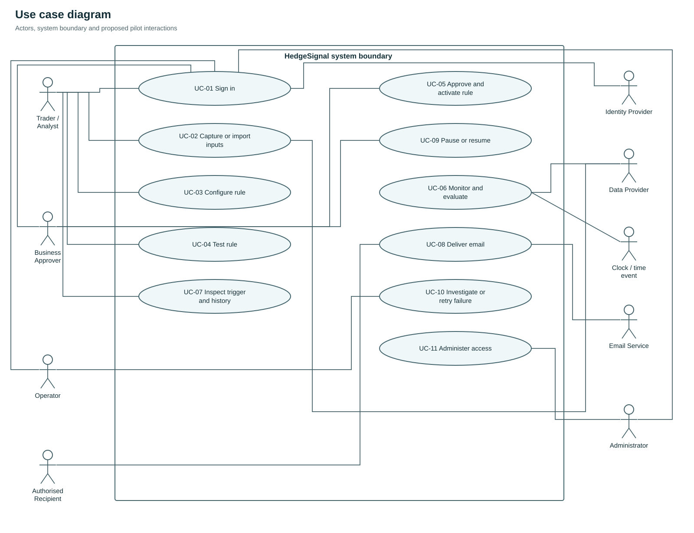
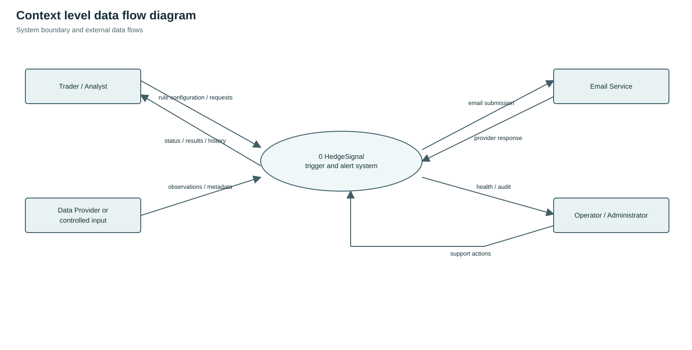
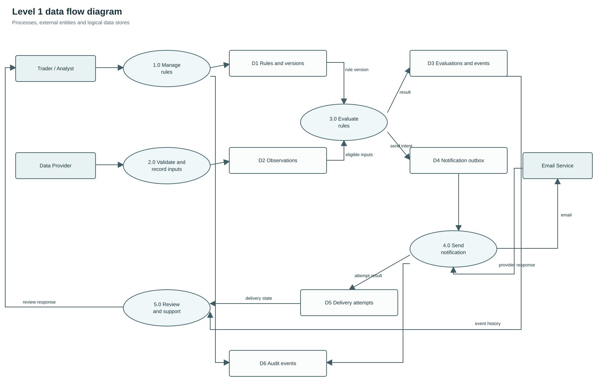
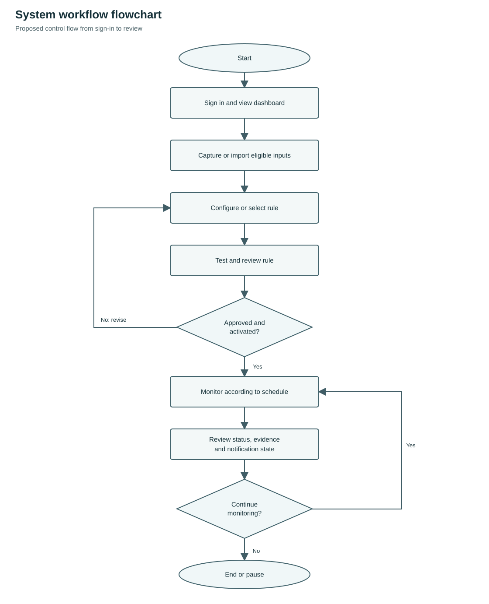
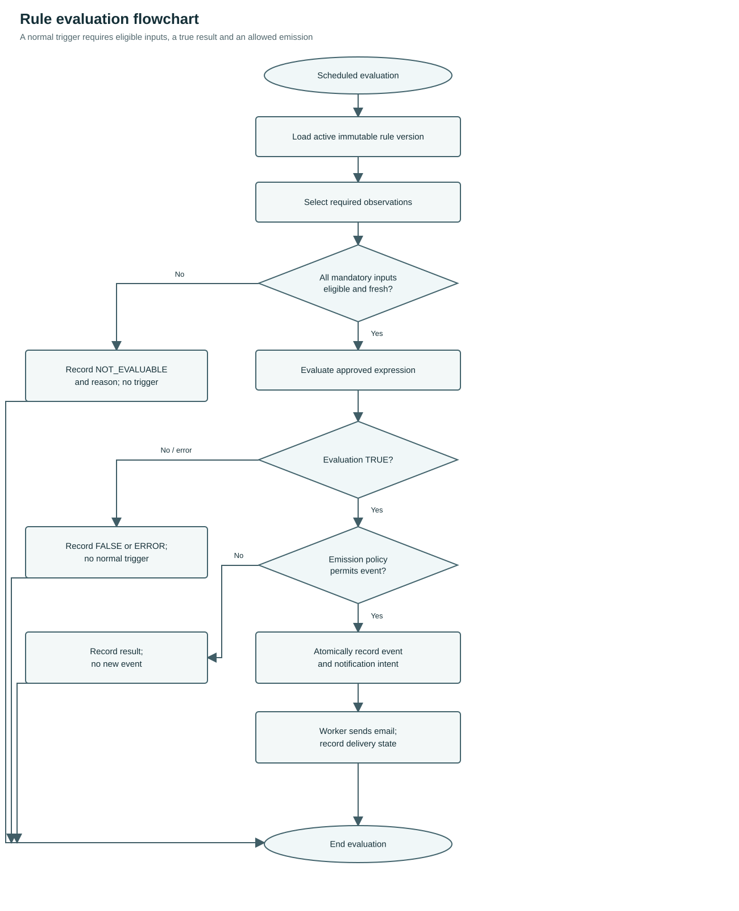
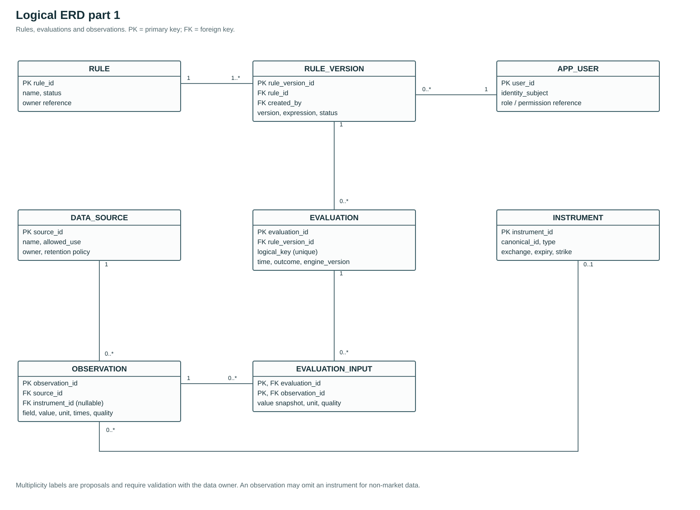
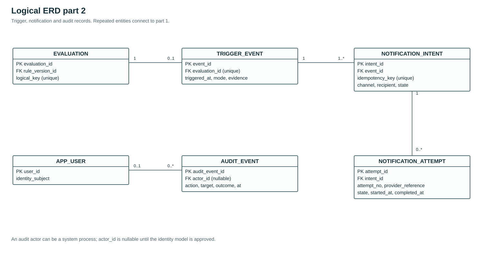
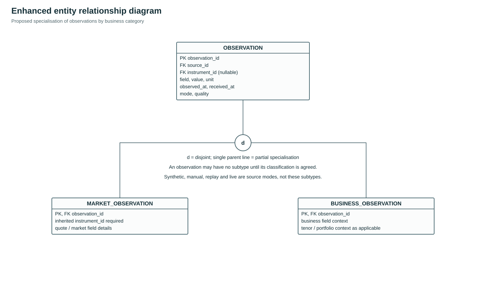
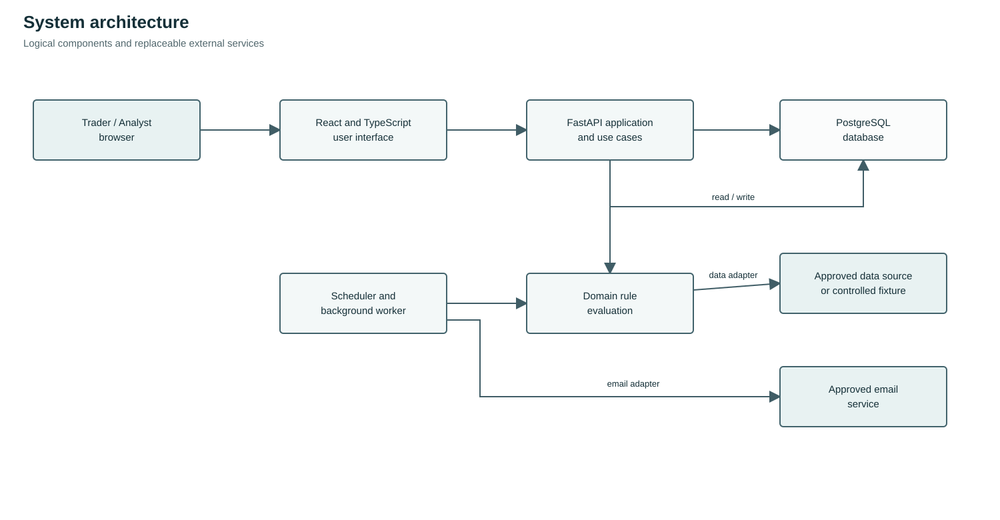
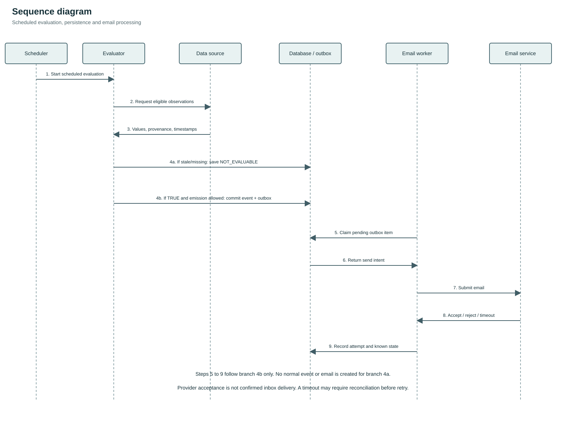

# HedgeSignal Software Requirements Specification and System Design

**Document ID:** HS-SRS-001  
**Version:** 0.2 — draft for stakeholder review  
**Date:** 5 November 2026  
**Classification:** Internal; confirm organisational classification before distribution.  
**Document owner:** Product owner, to be assigned  
**Status:** Proposed requirements and designs, pending review and approval.

## Revision history and approval

| Version | Date | Description | Review status |
|---|---|---|---|
| 0.2 | 5 November 2026 | Requirements, use cases, analysis models and design baseline | Draft; approval pending |

| Role | Responsibility | Name / approval date |
|---|---|---|
| Business owner | Approve scenarios, conditions, definitions and acceptance criteria | TBD |
| Product owner | Confirm priority, scope and release decisions | TBD |
| Technical lead | Review architecture, data design and feasibility | TBD |
| Market-data owner | Confirm access rights, mappings, retention and data quality | TBD |
| Security and IT | Review hosting, identity, access and operational controls | TBD |
| Operations owner | Approve support, monitoring and recovery arrangements | TBD |

## Table of contents

1. Introduction
2. Overall description
3. System features and functional requirements
4. External interface requirements
5. Non-functional requirements
6. Other requirements and analysis models
7. Verification and acceptance
8. Deployment and maintenance requirements
9. Open decisions
10. Appendices and references

## 1. Introduction

### 1.1 Purpose

This SRS defines the functional and quality requirements, user interactions, data design and verification approach for HedgeSignal. It supports a controlled alert pilot for agreed hedging scenarios, while retaining an extensible future product vision. Its audience includes traders, business owners, developers, testers, IT, data owners and support personnel.

### 1.2 Document conventions

Requirements use unique identifiers. **P0** indicates a proposed minimum pilot requirement; **P1** indicates a desirable capability; **TBD** identifies an unconfirmed decision. None is approved solely by appearing in this draft. Must/shall express proposed requirements; acceptance occurs only after the accountable owner approves the baseline. Related tests and use cases use TC and UC identifiers.

### 1.3 Product scope

HedgeSignal monitors business-approved hedging conditions, records the evidence behind each evaluation, presents trigger status and can send email alerts to approved recipients. Proposed pilot operation uses clearly identified synthetic, replay or authorised test data. Human users interpret and act on alerts. Live trade execution, routing orders, forecasting and paper-trade accounting require separate approval and are outside the proposed pilot.

### 1.4 Intended audience and reading guide

Business owners should review scope, actors, scenarios and use cases; developers should also review requirements, architecture and data models; testers should use the use cases and acceptance cases; IT and support should review external interfaces, security and operations.

### 1.5 Terminology

| Term | Meaning in this specification |
|---|---|
| Scenario | A business-defined hedging situation and the inputs and conditions that must be assessed together. |
| Rule version | An immutable, reviewable definition of the conditions, parameters and evaluation settings for a particular release of a rule. |
| Evaluation | One recorded attempt to assess a rule against a specific set of eligible inputs. |
| Trigger event | A durable record that the agreed trigger policy emitted an event; it is not an order, execution or proof of profitability. |
| Notification attempt | One attempt to hand an alert to an authorised delivery service. It is separate from the trigger event. |
| Synthetic data | Artificial values explicitly marked as synthetic; they are not market observations. |
| Test / replay data | Labelled data used to exercise or replay a rule; it may be synthetic or authorised historical observations, as identified by its provenance. |
| Replay | Deterministic evaluation of time-ordered recorded or synthetic inputs. Replay of triggers does not measure trading profit. |
| Market-data observation | A value, field, instrument, source and relevant timestamps with a known mode, quality and licence. |
| WAPL | A business field. Its expansion, relation to any WAP measure, population, formula, weighting, period, currency and business owner remain TBD. |
| Stale | An observation older than its approved maximum age, calculated from defined timestamps and evaluation time. The allowed age is TBD per field. |
| UTC | Coordinated Universal Time. A named display time zone is shown separately. |
| RLS | Database row-level security; relevant only where an exposed database API is enabled. |

### 1.6 References

Relevant technology and interface documentation is listed in Appendix 10.2. Company security, data classification and approved market-data agreements apply when available.

## 2. Overall description

### 2.1 Product perspective

The system is a browser application backed by an application service, a background evaluation worker, relational storage, a data adapter and an email adapter. It is independent of any single data provider or mail provider. Monitoring runs in the background and does not require a user to keep the browser open.

### 2.2 Product functions

1. Authenticate and authorise users.
2. Capture, validate and display input observations and their provenance.
3. Configure and review versioned rules for business-approved scenarios.
4. Test rules, activate or pause monitoring and evaluate eligible inputs.
5. Create a trigger event when an approved emission policy is satisfied.
6. Send a controlled email notification and record its outcome.
7. Review monitoring health, evaluation history, events and audit information.

### 2.3 User classes and actors

| Actor | Classification | Responsibility and involvement |
|---|---|---|
| Trader / Analyst | Primary human actor | Views inputs, configures and tests permitted rules, monitors and inspects events. |
| Business Approver | Primary human actor | Reviews approved business parameters and activates, pauses or resumes a rule when authorised. |
| System Administrator | Primary human actor | Maintains user access and permitted system configuration. |
| Support Operator | Primary human actor | Reviews health and resolves data or notification failures within assigned authority. |
| Authorised Recipient | Primary beneficiary | Receives and reviews an alert sent to an approved address. |
| Market Data Provider | Supporting external actor | Supplies entitled observations with source identity and timestamps. |
| Email Service | Supporting external actor | Accepts or rejects requests to deliver alert emails and may provide delivery evidence. |
| Identity Provider | Supporting external actor | Authenticates users when the organisation supplies an external identity service. |
| Clock / Time Event | Supporting external timing actor | Represents the passage of time triggering a scheduled evaluation; it is not the application's internal worker. |

The actual permissions, separation of duties and whether a user may hold more than one role are TBD and require approval. The system itself is not an external actor.

### 2.4 Operating environment

The pilot targets an organisation-approved modern desktop browser and deployment environment. Supported browsers, operating systems, network boundaries, corporate identity, workstation specifications and accessibility policy are TBD. Mobile adaptation is desirable, but the primary usage context and minimum supported viewport require user validation. A company-approved data and mail service are dependencies, as are time synchronisation, backup, user management and access to appropriately licensed fields. Budget allocation is a management decision.

### 2.5 Constraints and dependencies

- A trading subject-matter expert will define the first scenario and approve expected outcomes.
- The organisation will identify a data owner and approve input use, storage, access and retention before non-synthetic use.
- A service owner will approve infrastructure, accounts, identity, outbound mail and support arrangements.
- Unit definitions, applicable market calendar, quote type, freshness and treatment of missing data remain open until agreed.
- The system's time synchronisation and provider timestamp semantics must be confirmed.
- No data service, live feed, supplier entitlement, historical coverage or outgoing email integration is represented as already available.

### 2.6 User documentation

The pilot shall provide a user guide, rule-configuration guide, operating runbook, data-source register and recovery procedure. The accountable owner and final formats are TBD.

## 3. System features and functional requirements

Each requirement below is a proposed pilot baseline, not an assertion that the capability exists. Verification is defined in section 7. An implementation may reduce configuration flexibility where necessary, provided the approved first scenario is fully represented, the restriction is visible and no unsupported rule is silently interpreted.

### 3.1 Identity, permissions and system status

**Description and priority:** P0 baseline; individual P1 exceptions are marked below.  Control access and present the current operating status. **Stimulus and response:** A user requests access or opens the dashboard; the system validates identity and permissions, then displays the authorised status.

| ID | Priority | Requirement | Observable acceptance |
|---|---|---|---|
| FR-001 | P0 | Require authentication before accessing non-public pilot data and functions, using the approved identity mechanism. | An unauthenticated request is denied; no sensitive information appears in the response. |
| FR-002 | P0 | Enforce approved permissions on the server for viewing, editing, activation, pausing, user administration, data access and retry. | A user lacking a permission cannot perform the operation through the API or UI. |
| FR-003 | P0 | Display service mode (test/replay or authorised pilot), source status, last successful input and evaluation times, and current health. | User can distinguish a paused rule, unhealthy worker and stale/unavailable input without interpreting colour alone. |
| FR-004 | P0 | Show the latest evaluation result and reason as TRUE, FALSE, NOT_EVALUABLE or ERROR, separately from monitoring and notification status. | Missing input is not displayed as a false condition or a zero value, and an unexpected processing failure is identified as ERROR. |

### 3.2 Inputs and market data

**Description and priority:** P0 baseline; individual P1 exceptions are marked below.  Acquire and validate observations. **Stimulus and response:** A user or provider submits an input; the system validates its identity, unit, provenance and quality, accepting or rejecting it with a reason.

| ID | Priority | Requirement | Observable acceptance |
|---|---|---|---|
| FR-005 | P0 | Support a controlled synthetic dataset and an authorised manual/approved import path for the agreed fields. | A test dataset produces reproducible results and is clearly labelled; import cannot be mistaken for an entitled live feed. |
| FR-006 | P0 | For each input retain field identity, value, unit, instrument/contract where relevant, provider or origin, observation time, received time, mode and quality. | Event detail traces each input to its observation and recorded source. |
| FR-007 | P0 | Validate field type, range where defined, unit, mandatory metadata, contract identity and source permissions before an observation can be eligible. | Invalid records are rejected or quarantined with an actionable reason; they are not converted to zero. |
| FR-008 | P0 | Detect stale, missing, invalid, future-dated beyond the allowed skew and incompatible inputs using approved per-field policies. | An ineligible required input causes NOT_EVALUABLE and no signal. |
| FR-009 | P0 | Support reproducible, time-ordered evaluation of test inputs without using observations later than the evaluation time. | Identical frozen data, rule version and engine version produce the same outcomes; future observations do not change earlier results. |
| FR-010 | P1 | Provide a provider adapter for approved data when the exact field, rights and operational requirements are satisfied. | Configuration records provider, permitted mode and mapping; data activation is blocked until prerequisites are confirmed. |

### 3.3 Rule management

**Description and priority:** P0 baseline; individual P1 exceptions are marked below.  Maintain a structured and versioned scenario. **Stimulus and response:** An authorised user creates, changes or activates a rule; the system validates and records the requested version and state.

| ID | Priority | Requirement | Observable acceptance |
|---|---|---|---|
| FR-011 | P0 | Allow an authorised user to create or configure the approved first scenario through structured inputs or an administratively maintained template. | The system displays all parameters and produces the exact approved summary without requiring user code. |
| FR-012 | P0 | Validate required instruments, field units, operators, thresholds, grouping, schedule, source and policy before activation. | Invalid or unsupported combinations cannot be activated; validation identifies the missing or incompatible field. |
| FR-013 | P0 | Show a human-readable preview including scenario, every condition, data mode, recipients and trigger frequency before activation. | The preview agrees with the persisted structured rule version. |
| FR-014 | P0 | Save rule changes as a new immutable version; preserve prior versions and their event evidence. | An earlier event remains linked to the original values and settings after a later edit. |
| FR-015 | P0 | Let an authorised user activate and pause a validated version and display its current state. | After the approved pause boundary takes effect, no further business event is produced; any in-flight treatment is defined and tested, and activation and pause are auditable. |
| FR-016 | P0 | Apply an explicitly configured evaluation schedule and trigger policy. | Test evidence demonstrates the chosen once-per-transition, once-per-period or repeat/cooldown policy; no implicit default is presented as approved. |
| FR-017 | P0 | Prevent changes to a version from affecting an in-flight or historical evaluation. | Each evaluation uses one committed immutable rule version. |
| FR-018 | P1 | Allow a user to duplicate a rule as a new draft where permitted. | The copy has an independent identity and version; prior history is unchanged. |

### 3.4 Evaluation, trigger and audit

**Description and priority:** P0 baseline; individual P1 exceptions are marked below.  Evaluate eligible rules and preserve evidence. **Stimulus and response:** A scheduled evaluation is due; the system checks eligible inputs, evaluates the rule and records the result and any permitted event.

| ID | Priority | Requirement | Observable acceptance |
|---|---|---|---|
| FR-019 | P0 | Execute eligible active rules in the worker according to the agreed schedule, independent of browser state. | Closing the browser does not by itself stop a healthy worker's scheduled test evaluations. |
| FR-020 | P0 | Record every evaluation outcome with rule version, schedule/time, engine version, selected input references and condition diagnostics. | A reviewer can inspect why the recorded TRUE, FALSE, NOT_EVALUABLE or ERROR result occurred, subject to information available at the point of failure. |
| FR-021 | P0 | Create a durable trigger event only when the rule is TRUE and the approved emission/rearm policy permits it. | Reprocessing the same logical evaluation does not create another event. |
| FR-022 | P0 | Include input values, thresholds, units, sources, time and mode in event evidence. | The event explains all relevant conditions without relying on today's mutable rule or latest market values. |
| FR-023 | P0 | Record security-relevant actions, actor, timestamp, object, result and change references in an access-controlled audit trail. | Activation, pause, rule changes, input corrections and retry actions are inspectable. |
| FR-024 | P0 | Display history filtered at least by date, rule and event/notification state. | Filtering does not change evidence, and a selected event opens its versioned detail. |
| FR-025 | P0 | Handle input or worker recovery using an explicitly approved missed-run/replay policy. | A restart does not silently claim continuous monitoring or invent missed events; gaps are shown. |

### 3.5 Notification

**Description and priority:** P0 baseline; individual P1 exceptions are marked below.  Send and reconcile a test alert. **Stimulus and response:** An event generates a notification intent; the system submits it to the approved service and records the outcome.

| ID | Priority | Requirement | Observable acceptance |
|---|---|---|---|
| FR-026 | P0 | Queue a test email for authorised recipients after an emitted event, using an approved mail service. | An email attempt is associated with one durable event and its recipient list. |
| FR-027 | P0 | Include test or pilot mode, rule identity/version, instrument where applicable, condition, key values/units, source/time and event reference in the message. | A test recipient can reconcile email content to the event without treating synthetic values as live. |
| FR-028 | P0 | Track notification state independently of rule state and event creation. | A failed email leaves the event visible and does not erase or recalculate it. |
| FR-029 | P0 | Record attempts, provider responses and an approved retry policy; distinguish accepted from confirmed delivered and unknown. | Failure or ambiguous submission is shown accurately; no delivery is asserted without evidence. |
| FR-030 | P0 | Use an idempotency key or equivalent where supported and controlled retry to reduce duplicate emails. | Repeated processing of the same queued job does not create duplicate application send intents; ambiguous provider submissions are flagged for reconciliation. |
| FR-031 | P0 | Limit notification recipients, message contents and retry permissions according to company policy. | Unauthorised address changes are rejected and audited. |

### 3.6 Interface, test and support

**Description and priority:** P0 baseline; individual P1 exceptions are marked below.  Provide understandable screens and recovery. **Stimulus and response:** A user reviews results, tests a rule or investigates a failure; the system displays the relevant status, evidence and next action.

| ID | Priority | Requirement | Observable acceptance |
|---|---|---|---|
| FR-032 | P0 | Present a compact primary view with rule, current inputs, quality, last evaluation and alert state; provide access to event detail. | A target user can identify whether a rule is monitoring and why it emitted a test event. |
| FR-033 | P0 | Show loading, empty, stale, partial, paused, failed and unavailable states with text and a next step where appropriate. | Each state is distinguishable and missing values never appear as valid numeric zero. |
| FR-034 | P0 | Allow viewing data and evaluation times in UTC and an identified display time zone; preserve source time and timezone information. | A DST or time-zone conversion does not alter stored UTC instants. |
| FR-035 | P0 | Provide an administrator/support view for health, failures and recovery without exposing secrets. | A support user can identify a failed worker or notification and follow the runbook. |
| FR-036 | P0 | Enable controlled testing of rule logic with saved test cases and expected results before activation. | The user can inspect actual versus expected result for the approved scenario. |

### 3.7 Business scenarios and inputs

#### 3.7.1 Candidate inputs

The proposed scenarios use heterogeneous inputs; do not combine them into one expression without a signed business specification. The following list records possible inputs, not approved rule logic.

| Candidate field | Questions before implementation / activation | Examples of input origin |
|---|---|---|
| Base hedge volume / exposure | Scope, portfolio, unit, long/short sign, position date, source, update authority, whether dynamic or fixed | Position records or spreadsheets |
| WAPL | Expansion, formula, weights, population, time period, currency and unit, adjustment and rounding | Business records or spreadsheets |
| Futures / swap reference price | Exact instrument, listed contract or OTC reference, field (bid/ask/last/settlement), currency, unit, source time and contract month | Approved market-data provider |
| Implied volatility | Instrument, expiry, strike or moneyness, quote/model source, percent versus volatility points, valuation conventions | Approved data provider or calculation |
| Option premium | Exact option identity, underlying, call/put, strike, expiry, bid/ask/last/mark, currency and unit | Approved options data provider |
| Strategy / threshold | Exact operator, AND/OR grouping, parameter ownership, activation and repeat policy | Rule-based illustrations |

Possible input origins include internal business records and approved market-data services. Confirm access to each required field and the permitted automated use, display, storage and retention. Determine whether WAPL and volume are manual business inputs rather than a market feed. Distinguish data service from order routing and storage infrastructure.

#### 3.7.2 Proposed business scenario parameters

The following candidate scenario parameters require business confirmation before they are implemented. `⟨tenor⟩`, `⟨current normal level⟩` and `⟨mandate⟩` below are placeholders; angle brackets do not mean less-than in those placeholders. WAPL is a business field whose definition must be agreed; it must not silently be treated as a defined WAP formula.

| Scenario | Candidate condition or item | Clarification required |
|---|---|---|
| Base hedge volume | Volume for `⟨tenor⟩` < 10.5 million bbl | Tenor, population, source, units and relationship to other conditions. |
| Base hedge volume | Implied volatility: `⟨current normal level⟩` | No comparator is reliably specified; define instrument, normal level, source and condition. |
| Base hedge volume | All months' WAPL > USD 72/bbl | Month set, weighting/formula and handling of missing months. |
| Base hedge volume | Swap reference > USD 72/bbl | Reference instrument, provider and quote field. |
| Base hedge volume | Option price at 72/62 <= `⟨mandate⟩` | Define option structure, 72/62, premium basis, unit and mandate. |
| Base hedge volume with OT | Any month's WAPL < USD 72/bbl | Define OT, relevant months, formula and scope. |
| Base hedge volume with OT | Swap reference > USD 79/bbl | Contract, reference source and quote convention. |
| Base hedge volume with OT | Option price at 79/69 <= `⟨mandate⟩` | Define option structure, 79/69, premium and mandate. |
| Base hedge volume with OT | ATM option with USD 10 band and `⟨mandate⟩` | Define ATM, band, option structure and comparator; comparator requires confirmation. |

The candidate conditions do not yet define Boolean grouping, evaluation frequency, how branches relate, rearm policy, or exact input identities. **No executable expression is approved here.** Obtain a business-owned rule sheet with expected positive, negative and boundary examples before configuration. Possible data origins include internal business records and approved market-data services; verify each field, feed and entitlement.

#### 3.7.3 Business rule approval record

For every pilot scenario, obtain a signed record with: scenario ID and business purpose; author and approver; instruments and contract mappings; input definitions, units, values and sources; input timestamps and eligible age; formula and arithmetic precision; conditions and comparison operators; AND/OR grouping and evaluation order; schedule and calendar; eligibility and missing/stale handling; trigger-once/rearm/cooldown behavior; recipients; expected output; at least one positive, one negative, one boundary and one missing-data example; and effective dates/version. Record whether the scenario is hypothetical, replayed or based on authorised operational data.

#### 3.7.4 Example software test

**BR-EX-01 — synthetic test, not a trading instruction.** Given an authorised synthetic input `reference_price = 75.00 USD/bbl` and a synthetic threshold `80.00 USD/bbl`, evaluate `reference_price < threshold` using exact decimal arithmetic. Proposed test result: `TRUE`. At exactly `80.00`, the result is `FALSE` for the strict `<` operator. If the price is missing or stale, the result is `NOT_EVALUABLE`; the system records why and emits no business trigger. These values are chosen solely as software examples and do not reproduce or approve the proposed business scenarios.

No valid number, threshold, mathematical formula, market convention or calculation frequency should be invented to fill a business gap. Support for combined volume, WAPL, price, volatility and premium conditions is dependent on an approved expression and eligible data.

## 4. External interface requirements

### 4.1 User, hardware, software and communications interfaces

**User interface:** browser over HTTPS on approved network; supported browser/viewport matrix TBD.  
**Hardware:** approved user workstations and hosting; capacity, CPU, memory and storage TBD.  
**Software:** approved identity, Postgres, data providers, mail service and monitoring. Integration versions, contracts, credentials and service owners TBD.  
**Communication:** encrypted channels and approved outbound/inbound network paths; provider timeouts, rate limits and failure handling specified per adapter.

Threat scenarios to assess before non-synthetic use include unauthorised access, rule tampering, exposure of positions or market data, incorrect contract mapping, forged/duplicate emails, expired data rights, stale input, missed monitoring, leaked credentials and untested restore. Controls include authentication, server permissions, least privilege, immutable versions, audit, secret management, provenance, quality gates, deduplication, backups and operational review. Company security/IT decide the applicable standards and required independent review.

### 4.2 Application interfaces

These are illustrative internal contracts to refine after authorisation and user workflow decisions; they do not imply endpoints have been built. All mutations require authentication and permission, input validation and audit; sensitive responses are access controlled. Return structured errors with a safe code, user-facing message and correlation ID. HTTP examples below are not vendor APIs.

| Operation | Illustrative endpoint | Inputs / outputs |
|---|---|---|
| List rules | `GET /api/rules` | Paginated rules, status, mode and latest evaluation summary. |
| Draft a version | `POST /api/rules/{id}/versions` | Structured version, expression, units, source references and trigger policy; returns draft ID/version and validation status. |
| Validate | `POST /api/rule-versions/{id}/validate` | Returns errors, warnings and readable summary; does not activate. |
| Activate / pause | `POST /api/rule-versions/{id}/activate` / `POST /api/rules/{id}/pause` | Expected version/state for concurrency; audited transition. |
| Run controlled test | `POST /api/rule-versions/{id}/test-runs` | Dataset ID, as-of/range, expected cases; returns asynchronous run identity. |
| View evaluations and events | `GET /api/events?rule_id=...` and `GET /api/events/{id}` | Paginated evidence, timestamp, mode, rule version and delivery state. |
| System health | `GET /api/health/monitoring` | Authorised status, source freshness, worker last success and safe errors; no secrets. |
| Retry notification | `POST /api/notifications/{id}/retry` | Restricted operation with reconciliation result and audit reference. |

Example input value fragment: `{ "field": "reference_price", "value": "75.00", "currency": "USD", "unit": "bbl", "observed_at": "2026-11-05T08:00:00Z", "mode": "SYNTHETIC" }`. This is fictitious data. Contract and provenance fields would also be required for the relevant scenario.

### 4.3 Email service interface

Prefer an approved corporate email service. Verify identity, delegated or application permissions, mailbox restriction, allowed sender and recipients, throttling and support. Store recipient references and message templates under access control. Send no market-sensitive detail outside approved classifications. HTTP acceptance, where used, is not delivery confirmation. For uncertain outcomes, do not automatically assume failure or success; a retry may result in duplicate messages even with application-level deduplication if the provider does not offer end-to-end idempotency. Document provider-specific reconciliation and duplicate risk.

## 5. Non-functional requirements

Numeric limits below are proposed targets only where stated; `TBD` means they require a business decision and must not be represented as agreed service levels.

| ID | Category | Proposed requirement / acceptance evidence |
|---|---|---|
| NFR-001 | Correctness | Use exact decimal values and approved units for monetary thresholds. No display rounding may alter an evaluation. Test boundary, sign and unit conversion against business-approved examples. |
| NFR-002 | Reproducibility | A frozen ruleset, engine version and input snapshot must reproduce the same logical results; engine and rule versions are recorded. |
| NFR-003 | Data freshness | Define maximum age, observation-versus-receipt timestamp, clock-skew tolerance and eligible trading session for each field. All values are **TBD**; the default must not be presented as approved. |
| NFR-004 | Data integrity | Use database constraints, transactions and unique keys for event identity. The event and notification intent are committed atomically, or an equivalently verified recovery mechanism is used. |
| NFR-005 | Availability | Service hours, planned maintenance, target availability and response ownership are **TBD**. Health and monitoring gaps must be visible. |
| NFR-006 | Scheduling | Evaluation frequency, permitted delay, missed-run handling and market-calendar boundaries are **TBD**. Measure schedule lag; do not claim real-time operation without an agreed definition. |
| NFR-007 | Security | Apply least privilege, server-side authorisation, encryption in transit and at rest per company policy, secure secret storage and access review. Security approval is required for operational data. |
| NFR-008 | Authentication | Use company-approved identity, session controls and MFA where required by policy. SSO and the specific identity provider are **TBD**. |
| NFR-009 | Audit | Preserve audit and event evidence for an approved retention period. Retention, access, deletion, tamper-resistance and legal obligations are **TBD**. |
| NFR-010 | Backup and recovery | Define recovery point objective, recovery time objective, backup frequency, encryption and accountable owner; values are **TBD**. Demonstrate a restore in a non-production environment. |
| NFR-011 | Usability | Proposed goal: representative users can locate rule status, interpret an event and pause an authorised rule without assistance in a moderated task test; success threshold and sample are **TBD**. |
| NFR-012 | Accessibility | Target WCAG 2.2 AA for the supported workflow, subject to company policy. Verify keyboard, focus, labels, contrast, screen-reader names and non-colour status cues. |
| NFR-013 | Performance | Set approved response-time and workload targets after sizing users, rules, update rate and data volume. Measure on the approved test environment; no invented latency guarantee. |
| NFR-014 | Maintainability | Separate domain rules from provider, UI, persistence and email adapters; version dependencies and document setup, support, changes and rollback. |
| NFR-015 | Observability | Record worker health, freshness, evaluation errors, queue age and notification failures; designate alert thresholds, recipients and support hours as **TBD**. Do not log secrets. |
| NFR-016 | Privacy and rights | Classify inputs and messages; apply data-minimisation, access and provider licence restrictions, including automated/non-display and retention rights. |
| NFR-017 | Capacity | Estimate instrument count × fields × observations × retention plus events, indexes and backups; obtain measured costs and growth assumptions before selecting a plan. |
| NFR-018 | Resilience | A provider outage, network interruption or restart must surface degraded state. Recover without silently fabricating an evaluation or sending an unbounded duplicate alert. |
| NFR-019 | Compatibility | Supported browser versions, viewport widths, corporate network configuration and assistive technology matrix are **TBD**; test approved targets. |
| NFR-020 | Delivery | Keep separate development/test and approved operational environments; do not place company confidential data in an unapproved environment. |

## 6. Other requirements and analysis models

### 6.1 Use case model

The diagram identifies actors outside the system boundary and the services they initiate or participate in. Actor-to-use-case relationships must be interpreted with the proposed actor responsibilities in section 2.3; permissions are pending approval.



*Use case diagram*

#### 6.1.1 Use case summary

| Actor | Action | Description |
|---|---|---|
| Trader / Analyst, Business Approver, Administrator or Support Operator | UC-01 Sign in | User opens a protected area. |
| Trader / Analyst | UC-02 Capture or import inputs | New input values are available or the user starts an approved import. |
| Trader / Analyst | UC-03 Configure a rule | The user selects an approved business scenario to configure. |
| Trader / Analyst | UC-04 Test a rule | The user requests a controlled test of a draft rule. |
| Business Approver | UC-05 Review and activate a rule | An approver chooses a validated rule for activation. |
| Clock / Time Event | UC-06 Evaluate active rule | A scheduled evaluation becomes due. |
| Trader / Analyst | UC-07 Inspect monitoring and event history | User opens the monitoring view or selects an event. |
| Authorised Recipient | UC-08 Send an email alert | A valid event creates a notification intent ready for processing. |
| Business Approver | UC-09 Pause or resume monitoring | Approver selects pause or resume for a rule. |
| Support Operator | UC-10 Investigate and reconcile an outage | Monitoring reports an input, worker or email failure. |
| System Administrator | UC-11 Administer access and service configuration | An authorised administration request is received. |

#### 6.1.2 Use case descriptions

##### UC-01 Sign in

| Field | Description |
|---|---|
| Use Case ID | UC-01 |
| Use Case Name | Sign in |
| Primary Actor | Trader / Analyst, Business Approver, Administrator or Support Operator |
| Supporting Actors | Identity Provider |
| Triggering Event | User opens a protected area. |
| Brief Description | Authenticates a user and opens only the functions and information permitted by that user’s role. |
| Pre-conditions | Account is active; approved identity service is available. |
| Post-conditions | An authorised session is established; otherwise no protected data is disclosed. |
| Related Requirements | FR-001, FR-002, FR-023 |

**Flow of events**

| Step | Actor | System |
|---|---|---|
| 1 | User selects sign in. | — |
| 2 | — | System redirects to or presents the approved authentication mechanism. |
| 3 | User authenticates. | — |
| 4 | — | System validates the identity and session. |
| 5 | — | System loads the authorised role and opens the permitted dashboard. |

**Alternative flow**

- Invalid credentials: identity service denies access and the user may retry according to policy.

**Exception flows**

- Account disabled or role unavailable: system denies access and records the reason without exposing secrets.

##### UC-02 Capture or import inputs

| Field | Description |
|---|---|
| Use Case ID | UC-02 |
| Use Case Name | Capture or import inputs |
| Primary Actor | Trader / Analyst |
| Supporting Actors | Market Data Provider |
| Triggering Event | New input values are available or the user starts an approved import. |
| Brief Description | Captures or imports observations, validates their identity and quality, and records accepted data for evaluation. |
| Pre-conditions | User has data-entry permission; fields, units and provenance rules are configured. |
| Post-conditions | Eligible observations are stored and traceable; rejected inputs cannot be evaluated. |
| Related Requirements | FR-005–FR-010, FR-023 |

**Flow of events**

| Step | Actor | System |
|---|---|---|
| 1 | Actor selects the source and data mode. | — |
| 2 | Actor enters or imports the observations. | — |
| 3 | — | System validates field identity, value, unit, timestamp, instrument and authorisation. |
| 4 | — | System records eligible inputs and their origin and displays the import result. |

**Alternative flow**

- Invalid, future-dated, incomplete or unauthorised input is rejected or quarantined with a reason.

**Exception flows**

- Unavailable provider: system reports the outage and does not substitute a different instrument or zero.

##### UC-03 Configure a rule

| Field | Description |
|---|---|
| Use Case ID | UC-03 |
| Use Case Name | Configure a rule |
| Primary Actor | Trader / Analyst |
| Supporting Actors | Business Approver |
| Triggering Event | The user selects an approved business scenario to configure. |
| Brief Description | Creates a reviewable, versioned draft that expresses an agreed hedging scenario without programming. |
| Pre-conditions | Scenario definitions and role permissions exist; no rule is activated by this use case. |
| Post-conditions | A versioned draft is available for testing and review; monitoring remains inactive. |
| Related Requirements | FR-011–FR-014, FR-017 |

**Flow of events**

| Step | Actor | System |
|---|---|---|
| 1 | User chooses a scenario and eligible instrument or business scope. | — |
| 2 | User enters parameters, conditions, grouping, schedule and intended recipients as supported. | — |
| 3 | — | System validates fields, units, operators and mode. |
| 4 | — | System displays a readable preview. |
| 5 | User saves the configuration as a draft version. | — |

**Alternative flow**

- Required or incompatible values: system identifies each issue and retains the draft.

**Exception flows**

- Unsupported expression: system blocks saving or activation and explains the unsupported element.

##### UC-04 Test a rule

| Field | Description |
|---|---|
| Use Case ID | UC-04 |
| Use Case Name | Test a rule |
| Primary Actor | Trader / Analyst |
| Supporting Actors | None |
| Triggering Event | The user requests a controlled test of a draft rule. |
| Brief Description | Evaluates a rule against a controlled dataset and presents reproducible results for review. |
| Pre-conditions | A valid draft and an appropriately labelled synthetic or authorised replay dataset exist. |
| Post-conditions | A reproducible test result exists; a test does not authorise operational monitoring. |
| Related Requirements | FR-008–FR-009, FR-020–FR-022, FR-036 |

**Flow of events**

| Step | Actor | System |
|---|---|---|
| 1 | User selects a rule version, dataset and evaluation time or range. | — |
| 2 | — | System selects eligible observations without using future data. |
| 3 | — | System evaluates each condition and applies the test trigger policy. |
| 4 | — | System displays input evidence, per-condition results and actual versus expected outcomes. |
| 5 | User reviews and records the test result. | — |

**Alternative flow**

- Missing, stale or incompatible mandatory input yields NOT_EVALUABLE with a reason.

**Exception flows**

- Unexpected error is recorded as ERROR; no ordinary business trigger is generated.

##### UC-05 Review and activate a rule

| Field | Description |
|---|---|
| Use Case ID | UC-05 |
| Use Case Name | Review and activate a rule |
| Primary Actor | Business Approver |
| Supporting Actors | None |
| Triggering Event | An approver chooses a validated rule for activation. |
| Brief Description | Allows an authorised approver to confirm the exact rule version and place it into active monitoring. |
| Pre-conditions | Approver has permission; business scenario, version, inputs, mode and recipients have required approvals. |
| Post-conditions | The reviewed version becomes active, or the previous state remains unchanged on failure. |
| Related Requirements | FR-012–FR-017, FR-023 |

**Flow of events**

| Step | Actor | System |
|---|---|---|
| 1 | Approver opens the draft or validated rule. | — |
| 2 | — | System presents conditions, data source, version, schedule, emission policy and recipients. |
| 3 | Approver checks the summary and confirms activation. | — |
| 4 | — | System verifies the version has not changed and records actor and activation time. |
| 5 | — | System displays the new monitoring state. |

**Alternative flow**

- Missing approval or invalid rule: activation is blocked with an explanation.

**Exception flows**

- Concurrent edit after preview: system requests a fresh review before activation.

##### UC-06 Evaluate active rule

| Field | Description |
|---|---|
| Use Case ID | UC-06 |
| Use Case Name | Evaluate active rule |
| Primary Actor | Clock / Time Event |
| Supporting Actors | Market Data Provider |
| Triggering Event | A scheduled evaluation becomes due. |
| Brief Description | Checks eligible inputs against an active rule and records the evaluation and any allowed trigger event. |
| Pre-conditions | Rule version is active; a service worker and approved execution policy exist. |
| Post-conditions | A traceable evaluation exists; at most one logical event is recorded per allowed emission. |
| Related Requirements | FR-008, FR-016–FR-022, FR-025 |

**Flow of events**

| Step | Actor | System |
|---|---|---|
| 1 | The configured evaluation time occurs. | — |
| 2 | — | System starts the logical evaluation and obtains the active immutable rule version and relevant observations. |
| 3 | — | System checks input freshness, identity, permissions, units and completeness. |
| 4 | — | System evaluates the approved conditions using exact decimals. |
| 5 | — | System records TRUE or FALSE and condition evidence. |
| 6 | If TRUE and the emission policy permits, system atomically records a trigger and notification intent. | — |

**Alternative flow**

- Missing, stale or invalid mandatory observation: record NOT_EVALUABLE and no ordinary trigger.

**Exception flows**

- Unexpected processing failure: record ERROR, surface degraded health and follow recovery procedure.
- Result TRUE but policy suppresses repeat: retain evaluation without creating another event.

##### UC-07 Inspect monitoring and event history

| Field | Description |
|---|---|
| Use Case ID | UC-07 |
| Use Case Name | Inspect monitoring and event history |
| Primary Actor | Trader / Analyst |
| Supporting Actors | None |
| Triggering Event | User opens the monitoring view or selects an event. |
| Brief Description | Shows current monitoring status and allows a user to inspect the evidence and notification history of an event. |
| Pre-conditions | User is authenticated and authorised to view the relevant scenario. |
| Post-conditions | The user understands the current monitoring and recorded event without changing evidence. |
| Related Requirements | FR-003–FR-004, FR-022, FR-024, FR-032–FR-034 |

**Flow of events**

| Step | Actor | System |
|---|---|---|
| 1 | User opens the dashboard. | — |
| 2 | — | System displays rule state, current input quality, last evaluation and notification status. |
| 3 | User filters history by rule, date or status. | — |
| 4 | User opens an event. | — |
| 5 | — | System displays the immutable rule version, condition results, values, provenance, times and email status. |

**Alternative flow**

- No results: system shows an informative empty state.

**Exception flows**

- Missing or stale data and worker outage: system clearly displays the degraded state and reason.

##### UC-08 Send an email alert

| Field | Description |
|---|---|
| Use Case ID | UC-08 |
| Use Case Name | Send an email alert |
| Primary Actor | Authorised Recipient |
| Supporting Actors | Email Service |
| Triggering Event | A valid event creates a notification intent ready for processing. |
| Brief Description | Submits a trigger notification to the approved email service and records the known outcome of each attempt. |
| Pre-conditions | Approved sender, recipient and service configuration exist. |
| Post-conditions | Event remains durable and the email state reflects known evidence; duplicate risk is controlled. |
| Related Requirements | FR-026–FR-031 |

**Flow of events**

| Step | Actor | System |
|---|---|---|
| 1 | — | Worker claims a pending notification intent. |
| 2 | — | System creates a message identifying mode, scenario, event, relevant values and times. |
| 3 | — | Worker submits the message to the approved email service. |
| 4 | — | System records the attempt and provider response. |
| 5 | An authorised user reviews notification status alongside the event. | — |

**Alternative flow**

- Provider rejects request: record FAILED and follow the approved retry policy.

**Exception flows**

- Submission times out with uncertain outcome: record UNKNOWN and reconcile before a retry.
- Provider accepts: record ACCEPTED; mark DELIVERED only when reliable delivery evidence exists.

##### UC-09 Pause or resume monitoring

| Field | Description |
|---|---|
| Use Case ID | UC-09 |
| Use Case Name | Pause or resume monitoring |
| Primary Actor | Business Approver |
| Supporting Actors | None |
| Triggering Event | Approver selects pause or resume for a rule. |
| Brief Description | Changes the monitoring state of an authorised rule and records the actor and transition. |
| Pre-conditions | Approver has permission; rule and its current version exist. |
| Post-conditions | State transition is auditable. Treatment of an in-flight evaluation follows the approved transaction boundary. |
| Related Requirements | FR-015–FR-017, FR-023, FR-025 |

**Flow of events**

| Step | Actor | System |
|---|---|---|
| 1 | Approver selects the rule and requested action. | — |
| 2 | — | System shows its current state and the effect of the action. |
| 3 | Approver confirms the action. | — |
| 4 | — | System checks permissions and version, records the transition and displays the new state. |
| 5 | On resume, the worker follows the approved start and recovery policy. | — |

**Alternative flow**

- Concurrent state change: system asks the user to refresh before proceeding.

**Exception flows**

- Stale or unavailable data on resume: monitoring is displayed as degraded and normal trigger emission is blocked until eligible.

##### UC-10 Investigate and reconcile an outage

| Field | Description |
|---|---|
| Use Case ID | UC-10 |
| Use Case Name | Investigate and reconcile an outage |
| Primary Actor | Support Operator |
| Supporting Actors | Market Data Provider, Email Service |
| Triggering Event | Monitoring reports an input, worker or email failure. |
| Brief Description | Helps support staff identify an outage or uncertain notification and record an appropriate recovery action. |
| Pre-conditions | Support operator has the relevant permission; health information is available. |
| Post-conditions | The incident, monitoring gap and recovery actions remain auditable; no historical catch-up alerts are sent without policy. |
| Related Requirements | FR-025, FR-028–FR-030, FR-035 |

**Flow of events**

| Step | Actor | System |
|---|---|---|
| 1 | Operator opens the health view. | — |
| 2 | — | System displays the affected service, last successful time and safe error details. |
| 3 | Operator investigates the source, worker or notification state. | — |
| 4 | Operator reconciles an unknown email outcome or requests a permitted retry under policy. | — |
| 5 | Operator records the action and verifies recovery. | — |

**Alternative flow**

- Provider remains unavailable: keep the status degraded and escalate.

**Exception flows**

- An ambiguous submission cannot be safely reconciled: do not assert failure or guaranteed delivery; escalate.

##### UC-11 Administer access and service configuration

| Field | Description |
|---|---|
| Use Case ID | UC-11 |
| Use Case Name | Administer access and service configuration |
| Primary Actor | System Administrator |
| Supporting Actors | Identity Provider |
| Triggering Event | An authorised administration request is received. |
| Brief Description | Allows an authorised administrator to maintain access and approved configuration with an audit record. |
| Pre-conditions | Administrator has delegated permissions and the requested change is approved according to policy. |
| Post-conditions | Approved changes take effect and are audited; secrets are not displayed in audit records. |
| Related Requirements | FR-001–FR-002, FR-023, FR-031, FR-035 |

**Flow of events**

| Step | Actor | System |
|---|---|---|
| 1 | Administrator opens access or configuration settings. | — |
| 2 | Administrator selects the user, role or approved source setting. | — |
| 3 | — | System validates the requested change and permissions. |
| 4 | Administrator confirms the change. | — |
| 5 | — | System applies and audits the change. |

**Alternative flow**

- User lacks authority or the change violates policy: reject the request and record the result.

**Exception flows**

- Identity provider or service unavailable: report the issue and preserve the prior configuration.

### 6.2 Data flow diagrams

#### 6.2.1 Context diagram

The context diagram shows the system as a single process, its external entities and the data exchanged. It does not represent process sequencing.



*Context level data flow diagram*

#### 6.2.2 Level 1 data flow diagram

The level 1 diagram decomposes the system into rule management, input validation, evaluation, notification and review, together with logical data stores. Physical deployment may use one relational database.



*Level 1 data flow diagram*

### 6.3 Flowcharts

#### 6.3.1 Overall system flowchart

The overall flow covers authentication, scenario configuration, validation, testing, activation and monitoring. Rejection and pause return the user to a safe state. Test mode must be visibly labelled.



*System workflow flowchart*

#### 6.3.2 Rule evaluation and alert flowchart

The evaluator checks rule state and input eligibility before calculating a result. Missing, stale or invalid data produces NOT_EVALUABLE; processing failures produce ERROR. A FALSE result emits no trigger; TRUE requires the approved emission policy before an event and notification intent are committed. Email acceptance is distinct from confirmed delivery.



*Rule evaluation flowchart*

### 6.4 Rule lifecycle and evaluation contract

#### 6.4.1 States

Rule lifecycle: `DRAFT -> VALIDATED -> ACTIVE -> PAUSED -> ACTIVE`, with `DISABLED` as a terminal operational state for a version. Activation and pause require the relevant permission. Changes create a new draft/version rather than mutating the active rule. Whether validation/approval need distinct states and whether one user may approve their own rule are TBD.

Evaluation outcome: `TRUE`, `FALSE`, `NOT_EVALUABLE` or `ERROR`. NOT_EVALUABLE means a required input or prerequisite is missing, stale or incompatible; ERROR means an unexpected system failure. Neither emits a normal business trigger. A health alert to support, if required, is a separate operational notification.

Notification state: `PENDING -> SENDING -> ACCEPTED / FAILED / UNKNOWN`, optionally followed by `DELIVERED` or `BOUNCED` only when reliable provider evidence exists. `ACCEPTED` means the provider accepted the request; it does not prove receipt. A timeout after handoff may be UNKNOWN and requires a defined reconciliation process before retry.

#### 6.4.2 Evaluation contract

1. Obtain an active immutable rule version and one logical scheduled evaluation identity.
2. Select eligible input observations using the approved instrument/field mapping and as-of timestamp; do not substitute a different contract or quote field.
3. Validate rights, units, timestamps, freshness, market calendar, completeness and any synchronisation tolerance specified for combinations of inputs.
4. If any mandatory input is ineligible, persist NOT_EVALUABLE and the reasons; do not manufacture zero, a previous price or a signal.
5. Evaluate the approved structured expression with decimal arithmetic and explicit operators; retain each condition's value and outcome.
6. Apply the agreed emission policy using persisted state. Transition semantics, reset policy, equality treatment, cooldown, start-of-monitoring behavior and out-of-order observations are scenario decisions (TBD).
7. Commit the evaluation, unique trigger event and notification outbox item together when a trigger is emitted; otherwise commit the evaluation result only. This preserves recovery after a crash.
8. An independent sender claims outbox work, records attempts and reconciles outcomes under the approved retry and deduplication policy.

For a sample strict threshold, `x < y` is false when `x = y`. A future crossover requires explicit prior eligible observation and defined comparison boundaries; missing previous data is NOT_EVALUABLE, not proof of a crossing. For compound rules, three-valued handling and whether all conditions must have fresh data must be explicitly approved; this draft's conservative pilot proposal requires all mandatory inputs eligible before emitting.

#### 6.4.3 Restart, pause and concurrency

A worker must protect a logical evaluation with a unique identity and appropriate locking/transaction semantics. A retry reuses the same logical identity. Concurrent activation/edit requests use version checks so an approver does not activate a different rule than the one reviewed. Pause takes effect at a documented transaction boundary; whether an in-flight evaluation completes is TBD and must be visible/tested. On restart, calculate missed-run gaps and apply the approved catch-up policy. Until that decision is approved, do not automatically emit historical catch-up emails. Record all recovery decisions.

### 6.5 Database design

#### 6.5.1 Input data contract

| Attribute | Proposed representation | Validation / open issue |
|---|---|---|
| Observation ID | UUID or equivalent unique ID | Immutable identity. |
| Data mode | `SYNTHETIC`, `REPLAY`, `AUTHORISED_PILOT` | Display prominently; live/delayed quality is separate from mode. |
| Provider / origin | Stable source ID, source record ID | Verify licence and mapping. |
| Instrument | Source identifier and canonical identifier | For futures include exchange, contract month and expiry as applicable; for options include underlying, type, strike and expiry. |
| Field | Canonical field ID, quote type | E.g. `last`, `bid`, `ask`, settlement are distinct; never silently substitute. |
| Value / unit | Decimal string and approved unit/currency | Precision/scale per field TBD; preserve source precision and reject unsupported conversion. |
| Observed at / received at | Time-zone-aware UTC instants | Retain original source time/time zone where provided; source versus receipt freshness decision TBD. |
| Quality | Valid, stale, missing, delayed, invalid or unavailable as applicable | Missing/stale is a status, not numeric zero. |
| Retention / rights | Policy reference and expiry where applicable | Required for production data; verify permitted display, automated use and history. |

An option premium or volatility value must not be inferred from a futures price without an approved method, inputs and provenance. A market-wide Brent spot series cannot stand in for a specified contract-month futures option. Support inputs can come from distinct systems only when their time alignment, units, identities and permissions are explicitly specified.

#### 6.5.2 Entity relationship diagram

The ERD is the proposed logical relational model. Primary keys, foreign keys and optionality are specified below. `EVALUATION_INPUT` is an associative entity between EVALUATION and OBSERVATION. An evaluation may produce zero or one trigger event; notification intents are associated with emitted events according to recipient and channel policy.



*Logical ERD part 1: rules and observations*



*Logical ERD part 2: events and notifications*

#### 6.5.3 Enhanced entity relationship diagram

The EERD extends OBSERVATION as a conceptual supertype with optional, mutually exclusive MARKET_OBSERVATION and BUSINESS_OBSERVATION subtypes. The specialization is **partial and disjoint**: an observation may remain unclassified until the business approves its category, and cannot belong to both proposed subtypes. Data origin and mode (synthetic, replay, manual or authorised provider) are separate attributes, not subtypes. A subtype's `observation_id` is both its primary key and foreign key to OBSERVATION. This is a proposed classification and may be revised after input definitions are confirmed.



*Enhanced entity relationship diagram*

#### 6.5.4 Cardinality and relationship rules

| Parent | Relationship | Child | Cardinality / constraint |
|---|---|---|---|
| RULE | has | RULE_VERSION | One rule has one or more versions; each version belongs to exactly one rule. |
| RULE_VERSION | is evaluated by | EVALUATION | One version has zero or more evaluations; each evaluation uses exactly one version. |
| EVALUATION | uses | OBSERVATION via EVALUATION_INPUT | Many-to-many; each associative row references one evaluation and one observation. |
| DATA_SOURCE | supplies | OBSERVATION | One source supplies zero or more observations; each observation has one origin. |
| INSTRUMENT | identifies | OBSERVATION | An instrument has zero or more observations; an observation has zero or one instrument because business inputs may be non-market fields. |
| EVALUATION | may emit | TRIGGER_EVENT | An evaluation emits zero or one event; each event refers to exactly one evaluation. |
| TRIGGER_EVENT | creates | NOTIFICATION_INTENT | An emitted event creates one or more notification intents in the same transaction; each intent belongs to exactly one event. |
| NOTIFICATION_INTENT | records | NOTIFICATION_ATTEMPT | An intent has zero or more attempts; each attempt belongs to exactly one intent. |
| APP_USER | creates | RULE_VERSION | A user may create zero or more versions; each version records its creator. |
| APP_USER | performs | AUDIT_EVENT | A user may perform zero or more audited actions; each event refers to zero or one application user because automated actions may use a separate approved service identity. |
| OBSERVATION | generalises | MARKET_OBSERVATION, BUSINESS_OBSERVATION | Partial, disjoint specialisation; each subtype row has exactly one parent observation. |

#### 6.5.5 Logical data dictionary

Schema is proposed, not migration-ready until data, authorisation and retention decisions are approved. `numeric(p,s)` must be sized per validated source; use decimal strings at API boundaries to avoid binary floating-point conversion. `timestamptz` represents an instant and should be presented with a named zone.

| Entity | Proposed core attributes | Integrity / design notes |
|---|---|---|
| `app_user` | id UUID PK; identity_subject; role/permission reference; status; created_at timestamptz | Never store passwords or security tokens in audit rows; identity and access model TBD. |
| `data_source` | id UUID PK; name; source_type; licence_reference; allowed_mode; allowed_use; retention_policy; owner | Record decision/expiry; do not store credentials here. |
| `instrument` | id UUID PK; source_symbol; canonical_id; type; exchange; expiry; underlying_id FK; strike numeric; option_type; currency; unit | Required fields vary by instrument; identity and roll policy must be approved. |
| `observation` | id UUID PK; source_id FK; instrument_id FK nullable for non-market inputs; field_id; value numeric; unit; observed_at; received_at; source_time_text; mode; quality | Required/unique keys determined by provider; correct by a new version or superseding record, preserving audit. |
| `rule` | id UUID PK; name; owner; status; created_at | Stable identity; access controlled. |
| `rule_version` | id UUID PK; rule_id FK; version integer; expression JSONB; trigger_policy JSONB; schedule; mode; approved_by; approved_at; created_by; created_at | Unique `(rule_id, version)`; immutable once active; validate schema and version. Approval attributes nullable until approved. |
| `evaluation` | id UUID PK; rule_version_id FK; logical_key unique; scheduled_at; evaluated_at; outcome; reason; engine_version; diagnostics JSONB | Atomic selection/evaluation snapshot; no implicit update of historical results. |
| `evaluation_input` | evaluation_id FK; observation_id FK; value_snapshot numeric; unit; field_id; observed_at; quality | Composite key; snapshot plus source reference protects reproducibility under corrected input records. |
| `trigger_event` | id UUID PK; evaluation_id FK unique; event_key unique; triggered_at; evidence JSONB; mode | At most one event for a given logical emission under the chosen trigger policy. |
| `notification_intent` | id UUID PK; event_id FK; channel; recipient_reference; idempotency_key unique; state; next_attempt_at | Commit with event; recipient disclosure and grouping policy TBD. |
| `notification_attempt` | id UUID PK; intent_id FK; attempt_no; started_at; completed_at; state; provider_reference; safe_error | Append attempts; unique `(intent_id, attempt_no)`; no secrets. |
| `audit_event` | id UUID PK; actor_id FK nullable; actor_type; service_identity where applicable; action; target; outcome; at; change_reference; safe_details | Append-only controls and retention per policy; never include credentials. |
| `market_observation` | observation_id UUID PK/FK -> observation.id; market_attribute metadata TBD | Optional subtype; the parent observation's existing instrument_id must be present for this subtype. There is no duplicate instrument foreign key in the subtype. |
| `business_observation` | observation_id UUID PK/FK -> observation.id; business_scope metadata TBD | Optional subtype; field, population and units require business approval. |

Indexes, partitioning, exact precision, access rules, foreign-key deletion behavior and storage sizing require design review with real workload and company policy. Licensed market data may require shorter retention or restrictions on copying snapshots; negotiate a compliant evidence strategy rather than assuming indefinite storage.

Subtype tables are conceptual design options; their final attributes and physical implementation must be validated with the trading and data owners. The parent OBSERVATION.instrument_id is nullable generally, but required for a MARKET_OBSERVATION. Primary and foreign keys are not substitutes for a data-retention and market-data rights review.

### 6.6 Application architecture



*System architecture*

The proposed application uses React, TypeScript and Vite for the user interface; Python and FastAPI for the application service; PostgreSQL for persistent records; and a background worker for scheduled evaluation and notification. Provider and email adapters isolate external services from business rules. All infrastructure selections are subject to organisational approval.

### 6.7 User interface design

1. **Monitor:** current mode and service health; active/paused rules; latest eligible inputs with source, units and times; latest evaluations and alerts; clear access to event details.
2. **Rule detail / setup:** business scenario, structured input fields, readable condition summary, validation, approved version, data mode, recipients and activation/pause controls according to permission.
3. **Event detail:** event timestamp and mode; complete rule/version; per-condition values, thresholds and outcomes; source/time/quality; delivery status and attempts as permission allows.
4. **History and support:** filterable events, evaluation and delivery history; operational health, monitoring gaps and resolution status according to role.

```text
HedgeSignal                                      TEST DATA    Worker: healthy
Rule: [Scenario name]     Status: Monitoring      Last evaluated: [time + zone]
Inputs: [field / value / unit] [source] [data time] [quality]
Result: [TRUE / FALSE / NOT EVALUABLE / ERROR]  Reason: [readable explanation]
Recent events: [time] [rule version] [status] [open details]
Actions (if authorised): [Review rule] [Pause]
```

This is a conceptual wireframe, not a validated final layout. At narrow widths, stack information and preserve labels; avoid clipping critical values. Dates and numbers must have explicit units, currency and time zone. Maintain alignment and numeric legibility in dense views. Avoid relying on colour, animation or unexplained icons for status.

#### 6.7.2 Interaction states and usability test

For each action define `idle -> pending -> success` or `failure -> recovery`, prevent accidental double submission and preserve draft input on validation errors. Separate no records from source error. Explain why a control is disabled and what the authorised user can do. Warn about unsaved work. Display stale and unavailable data, and avoid implying monitoring is healthy when the worker is down.

Proposed discovery exercise: observe 3–5 representative users, if available, performing (1) locate monitoring state, (2) interpret a fired rule and its data age, (3) review/activate a synthetic rule, and (4) identify a failed email and pause the rule. Record completion, errors, time, questions and suggested improvements. This is an initial qualitative sample, not a statistically guaranteed usability result. Obtain agreed targets and retest after changes.

### 6.8 Sequence diagram

The sequence diagram shows a scheduled evaluation, retrieval of rule and input observations, eligibility checks, durable evaluation and the conditional event and email flow. Missing or stale mandatory inputs end in NOT_EVALUABLE without a trigger. A provider's acceptance of an email is recorded independently from actual delivery.



*Evaluation and notification sequence diagram*

## 7. Verification and acceptance

### 7.1 Test strategy and illustrative cases

Test domain logic independently using approved examples; then test persistence, scheduling, provider adapters, notification and UI together in a separate environment. Use synthetic or explicitly authorised data. The business owner must approve expected results before operational acceptance. The table is an initial test set, not evidence that tests have run.

| ID | Scenario and input | Expected outcome | Key requirements |
|---|---|---|---|
| TC-001 | Synthetic 75.00 < 80.00 | TRUE with source, times, unit and rule version recorded | FR-006, 019–022; NFR-001 |
| TC-002 | Synthetic 80.00 < 80.00 | FALSE; no business trigger | FR-020–021; NFR-001 |
| TC-003 | Required price missing | NOT_EVALUABLE with reason; no trigger or email | FR-004, 008, 020–021 |
| TC-004 | A required price exceeds its approved age | NOT_EVALUABLE; stale indicator and monitoring health visible | FR-003–004, 008; NFR-003 |
| TC-005 | Approved compound rule has one missing mandatory value | No emission under the proposed conservative policy; each diagnostic is visible | FR-008, 020–022 |
| TC-006 | Synthetic rule version edited after an event | Historical event still identifies original version and its evidence | FR-014, 017, 022 |
| TC-007 | Scheduler retries one logical evaluation after restart | At most one logical trigger event; gap/recovery recorded | FR-021, 025; NFR-004 |
| TC-008 | Provider accepts email then connection times out | State UNKNOWN unless provider evidence resolves it; no unsupported delivery claim | FR-028–030 |
| TC-009 | Provider explicitly rejects a message | Event remains; failure and safe reason visible; retry governed by policy | FR-028–030 |
| TC-010 | Unauthorised actor calls activate endpoint | Request denied and attempt audited according to policy | FR-001–002, 023 |
| TC-011 | Two users change rule after preview | Stale version cannot be activated without review | FR-013–015, 017 |
| TC-012 | Browser closes during an active controlled test | Worker continues according to its schedule; status is visible when reopened | FR-019; NFR-005–006 |
| TC-013 | Dataset contains future or out-of-order observation | No future value is used in an earlier evaluation; late-data policy applied and recorded | FR-008–009, 025 |
| TC-014 | Input contract or unit mismatches configured rule | Reject or mark ineligible; no silent conversion/substitution | FR-007–008, 012 |
| TC-015 | Keyboard-only user reviews event and pauses test rule | Critical controls are reachable, labelled and show visible focus | FR-032–033; NFR-011–012 |
| TC-016 | Restore approved backup in test environment | Restore is documented and evaluated against agreed RPO/RTO | NFR-010 |
| TC-017 | Send a test email to an authorised test mailbox | Message is marked test and reconciles with recorded event; delivery state reflects evidence | FR-026–029 |
| TC-018 | Approved scenario is tested at boundaries and with real-world units in a controlled dataset | Actual results match signed business examples, including equality, grouping and precision | FR-011–013, 020; NFR-001–002 |

### 7.2 Traceability coverage

| Requirement group | Verification |
|---|---|
| FR-001–004 | TC-003, 004, 010 and UI role/health tests |
| FR-005–010 | TC-003–005, 013–014 and source entitlement review |
| FR-011–018 | TC-006, 011, 018 and lifecycle/version tests |
| FR-019–025 | TC-001–007, 012–013 and recovery tests |
| FR-026–031 | TC-008–009, 017 and recipient/permission checks |
| FR-032–036 | TC-015, 018 and moderated user tasks |
| NFR-001–020 | TC-001–018 plus security, capacity, accessibility, operational and approved-service reviews |

Detailed test procedures, environment, actual evidence, pass/fail, defects and approver must be recorded during execution. Missing numeric targets, approved rule examples or available data are blockers for the corresponding operational acceptance, not automatic passes.

### 7.3 Proposed exit criteria

- Business owner approves the first scenario, rule version, examples, scope and interpretation.
- All P0 requirements are either demonstrated with evidence or explicitly deferred through documented approval; no unresolved critical defect undermines correct monitoring or security.
- Synthetic/replay results agree with approved expected outcomes, including boundaries and ineligible inputs.
- For an authorised operational-data pilot, IT and data owners approve hosting, data rights, quality, monitoring, recipients and support; test-only evidence alone is insufficient.
- Email event and attempt status are reconciled, including failures and ambiguity; a restore test and operational runbook are reviewed.
- Representative users complete agreed UAT tasks; outcomes, residual risks and owners are signed off.

## 8. Deployment and maintenance requirements

Provision distinct development/test and pilot environments with separate credentials and data. Automate repeatable deployments and version database changes. Record the code version, schema version, configuration and rollback procedure for every deployment. A staged release should include pre-deployment checks, backup, health verification and a rollback decision owner.

Operations runbook must identify source owner, system owner, support hours, on-call/escalation, health checks, log access, source and worker outage procedures, notification reconciliation, recovery/catch-up policy, backup restore procedure and periodic permission/data-rights review. During a monitoring gap, show the last confirmed evaluation and disclose the period affected. Retention and evidence export are subject to licence and company policy.

## 9. Open decisions

| ID | Decision / question | Proposed owner | Dependent requirements |
|---|---|---|---|
| OD-01 | Which exact business scenario and objective are first? | Trading lead | FR-011–016, all UAT |
| OD-02 | Define and approve all formulas, thresholds, units, AND/OR groupings and worked examples. | Trading lead | FR-012, 020–022; NFR-001 |
| OD-03 | Which contract month, instrument, option terms, quote field and roll/calendar conventions apply? | Trading and market-data owner | FR-006–010 |
| OD-04 | What is the definition, population and source of volume, exposure and WAPL? | Trading lead | FR-005–008 |
| OD-05 | Which sources provide required fields and permit automated use, display, storage, retention and redistribution? | Market-data owner / legal | FR-006–010; NFR-016 |
| OD-06 | What is the update schedule, permitted age, timestamp and synchronisation tolerance? | Trading and data owners | FR-008, 019; NFR-003, 006 |
| OD-07 | What are trigger policy, equality, rearm, cooldown, outage/restart and missed-run rules? | Trading owner | FR-016, 021, 025 |
| OD-08 | Who can create, approve, activate, pause, retry and view data? | Business and security owners | FR-001–002, 015, 031 |
| OD-09 | What approved identity, infrastructure, location, database and email platform are available? | IT and service owners | NFR-007–010, 020 |
| OD-10 | What are recipient list, message classification, delivery expectations and retry/reconciliation policy? | Business / IT | FR-026–031 |
| OD-11 | What are service hours, support ownership, RPO/RTO, backup and monitoring targets? | Operations / IT | NFR-005, 010, 015 |
| OD-12 | What date and exit criteria are approved; does the pilot include paper trading? | Sponsor / product owner | Scope and release plan |
| OD-13 | Which usability, accessibility, performance and load targets apply? | Product owner / IT | NFR-011–013, 019 |
| OD-14 | What data retention and audit-evidence approach is permitted by both company policy and provider licence? | Data owner / legal / IT | NFR-009, 016 |

## 10. Appendices and references

The following are retained as future candidates, not lost requirements: natural-language rule interpretation with clarification and user review; structured AND/OR rule groups; historical trigger backtesting and reports; futures charts, SMA/EMA indicators, contract selection, futures curve and calendar spreads; option chain and premium/Greek thresholds; multi-leg strategies and 3D implied-volatility analysis. Their priority, data coverage, valuation conventions and acceptance criteria require separate design and approval. A continuous futures series is an analytical construction and must not be confused with a specific listed contract; options require the correct underlying and quote/valuation conventions. Simulated trade performance, paper trading and any real execution require a separate scope, assumptions, controls and release gate.

### 10.1 Future product capability catalogue

The smaller pilot is a **proposal** and must be confirmed as a scope decision. These items are recorded so that a later release can be specified without losing the original vision. Each future item needs independently approved details and tests.

| ID | Capability | Proposed phase / dependency |
|---|---|---|
| VIS-01 | Connected Rules & Alerts, Market Explorer and Options Lab sharing selected instrument and context. | Future; UX and integration decisions. |
| VIS-02 | Plain-English input translated to inspectable structured rules, with clarification instead of guessing ambiguous details. | Future; parsing limits and review requirements. |
| VIS-03 | Visual IF/AND/OR condition builder, nested grouping and readable summary. | Pilot: approved structured scenario only; general-purpose builder future. |
| VIS-04 | Futures instruments: exact expiry, front month and continuous series with clear distinction. | Pilot: approved exact instrument; mappings and roll methodology required for broader support. |
| VIS-05 | Price levels/crossings, absolute and percentage moves, rolling highs/lows and time windows; SMA/EMA crossing and slopes. | Future; exact eligible price, calendar, lookback, crossing and indicator conventions. |
| VIS-06 | Evaluation per update or closed bar; once per crossing or bar, repeat, reset and cooldown. | Pilot: one approved policy; broader configurable semantics future. |
| VIS-07 | Saved rules, search, folders/tags, version history, duplicate, pause/resume and compare parameter variations. | Pilot: core lifecycle, version and history; remaining organisational tools future. |
| VIS-08 | Historical trigger backtest with selectable range, data and timeframe; counts, event-period percentage, gaps, distribution, timeline, chart and condition diagnostics. | Future full capability; pilot controlled replay validates logic. Define denominators and coverage. |
| VIS-09 | Simulated strategy metrics including return, drawdown, wins/losses and costs only with explicit trade entry/exit, position and execution assumptions. | Future separate scope and approval; alert frequency never equals profitability. |
| VIS-10 | Chart lines/candles, contract and date selection, pan/zoom, optional volume, multiple configurable SMA/EMA overlays and create-rule actions. | Future; entitled history and indicator calculations. |
| VIS-11 | Chart threshold lines, condition regions, event markers, inspection and optional bar-by-bar replay without future-data leakage. | Future; consistent evaluator and chart context. |
| VIS-12 | Futures curve by listed expiry, signed calendar spreads, context explanations and direct rule creation from a point. | Future; synchronised licensed contract snapshots and definitions. |
| VIS-13 | Historical curve overlay and comparisons; slope, calendar spread and contango/backwardation conditions. | Future; approved history and calculation semantics. |
| VIS-14 | Options ladder with calls, strikes and puts, expiry/type filters and actual underlying futures reference. | Future; accurate contract mapping and licensed option-level data. |
| VIS-15 | Bid, ask, last, spread, IV, delta, gamma, theta, vega, optional open interest/volume, column selection and stale/unavailable labelling. | Future; provider fields, units, model and calculation assumptions. |
| VIS-16 | Option alert created from a selected row, premium field selection and premium/Greek/IV/spread-change rules. | Future; quote field selection and eligible prices. |
| VIS-17 | Visual strategy builder for vanilla, vertical spreads and collars with signed legs, contracts, quantities and explicit underlying exposure. | Future; strategy definitions and supported positions. |
| VIS-18 | Combined premium, debit/credit, net Greeks and strategy-level alerts with explicit sign and unit conventions. | Future; model, quote synchronisation and financial methodology. |
| VIS-19 | 3D IV surface with strike/moneyness, time-to-expiry and IV; rotate/zoom/inspect, snapshot and underlying filters and point provenance. | Future; data coverage, methodology and accessible alternative. |
| VIS-20 | Contextual explanations of skew, smile and term structure; historical surface comparison and IV spread alerts. | Future; calculation and timestamp methodology. |
| VIS-21 | Cross-panel discover → define → test → activate → review workflow, including linking event evidence to a chart. | Future; no silent change of instrument, timeframe or data mode. |
| VIS-22 | Across all panels: progressive disclosure, validation, calculation transparency, reproducibility, test/live and data-quality labels, actionable explanations, no hidden trade execution. | Pilot subset applies now; full vision applies to future capability. |

Prioritisation of historical curve overlays, advanced grouping and surface analytics requires product owner approval.

### 10.2 References

1. React documentation, https://react.dev/learn
2. FastAPI documentation, https://fastapi.tiangolo.com/python-types/
3. Supabase production checklist, https://supabase.com/docs/guides/deployment/going-into-prod
4. Microsoft Graph email processing, https://learn.microsoft.com/en-us/graph/outlook-things-to-know-about-send-mail
5. U.S. Energy Information Administration open data, https://www.eia.gov/opendata/

**End of SRS**
