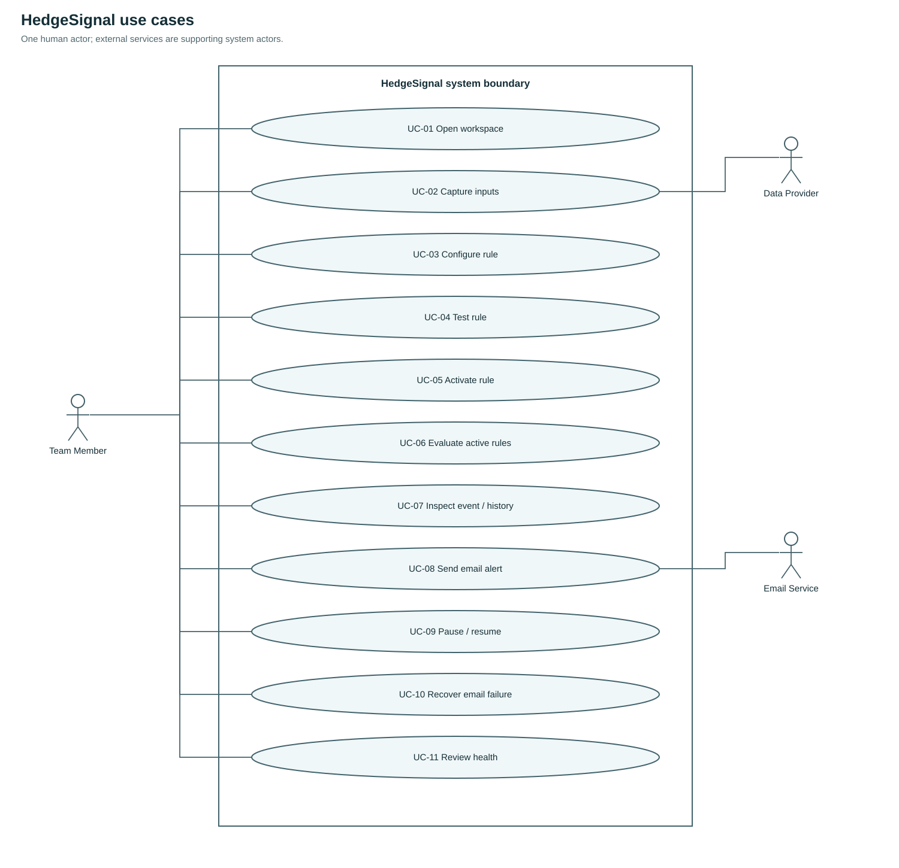
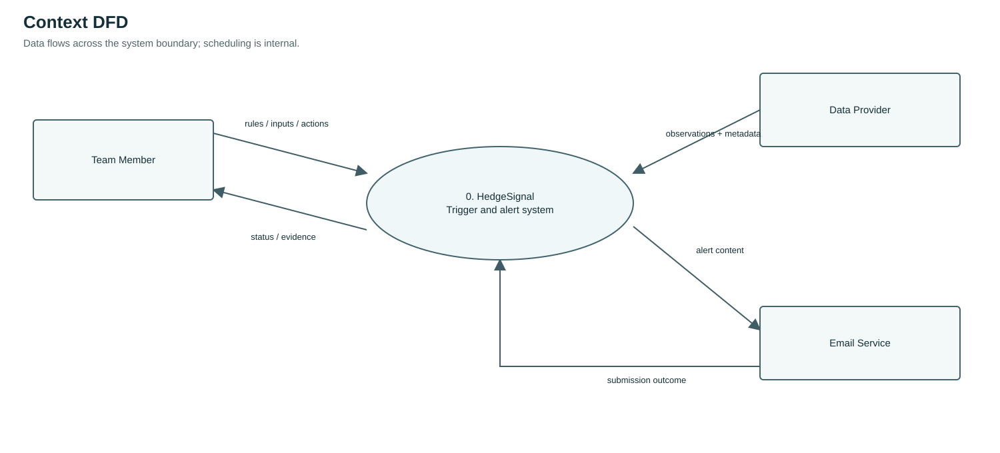
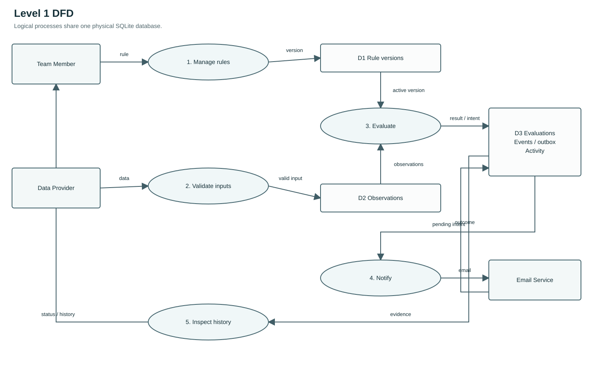
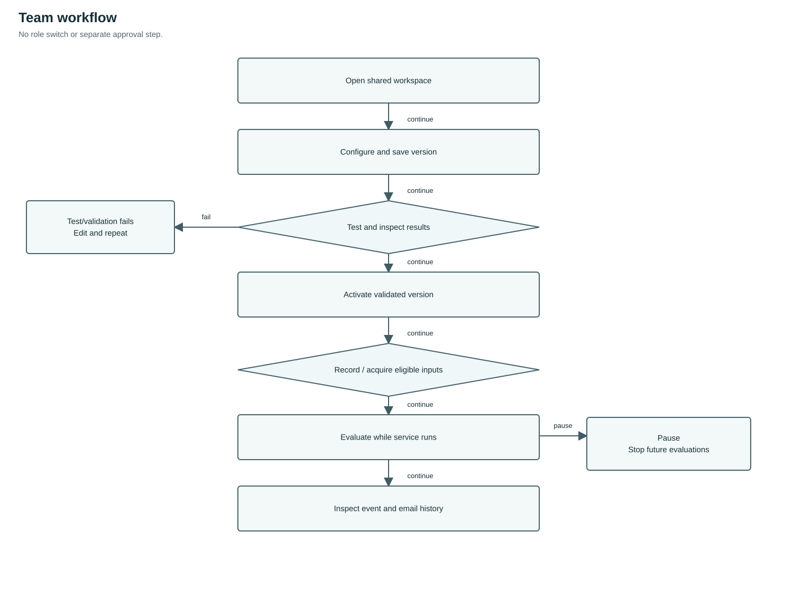
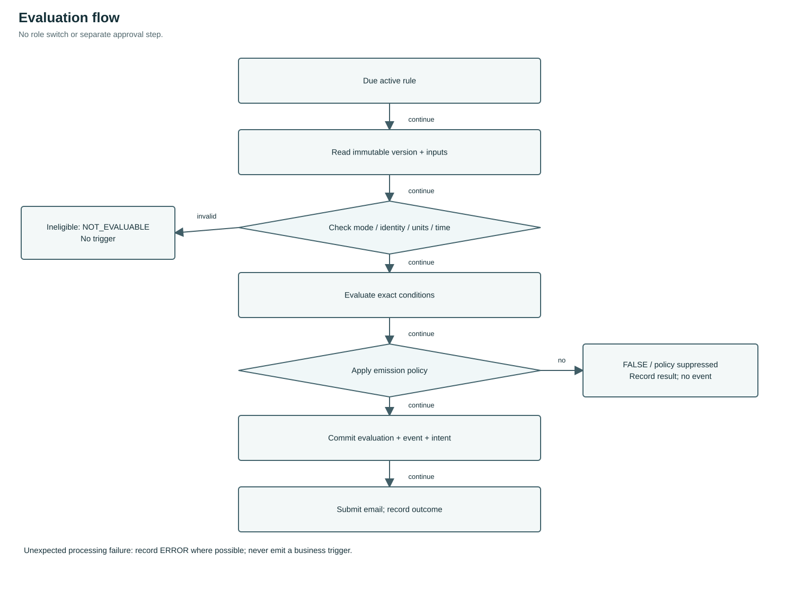
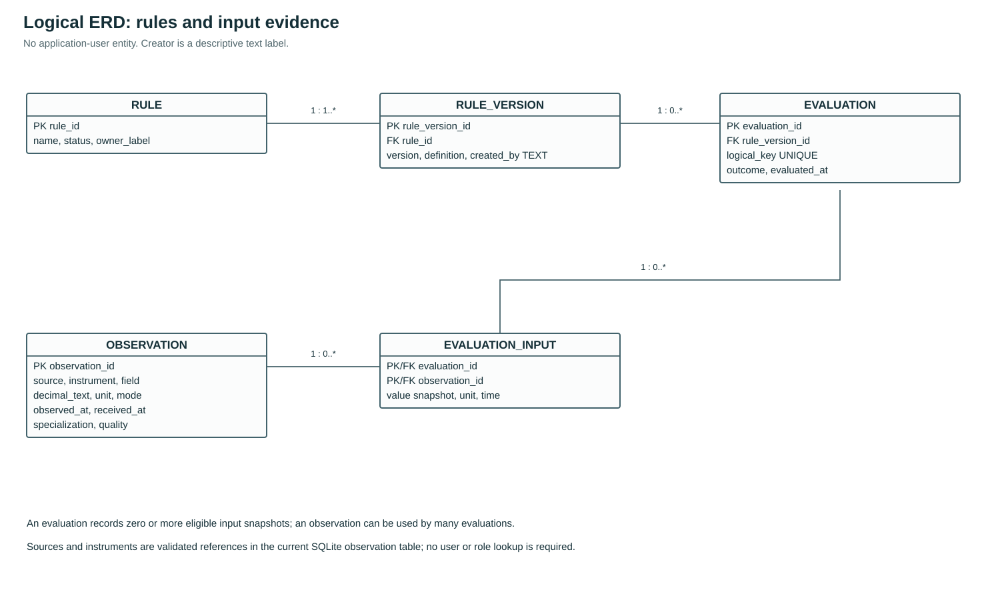
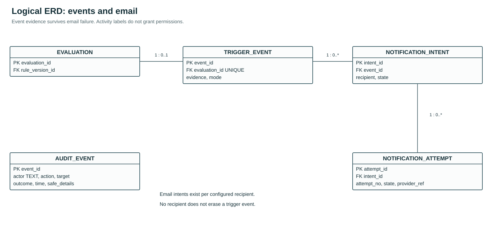
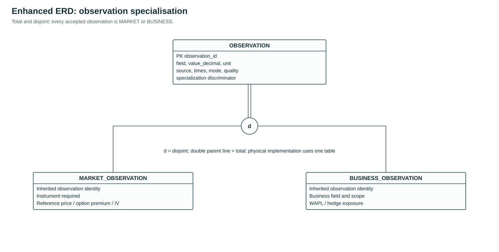
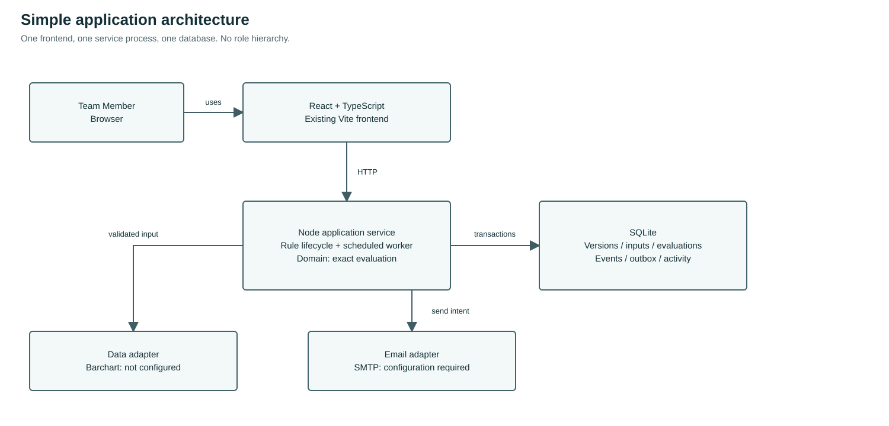
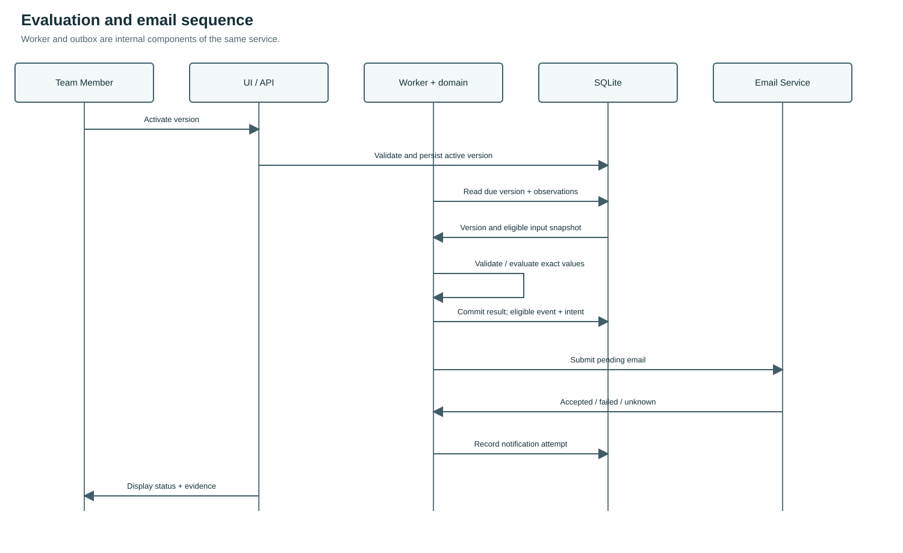

# HedgeSignal Software Requirements Specification and System Design

**Document ID:** HS-SRS-001  
**Version:** 0.3 — draft for stakeholder review  
**Date:** 10 November 2026  
**Classification:** Internal; confirm organisational classification before distribution.  
**Document owner:** Development team  
**Status:** Proposed requirements and designs, pending review and approval.

## Revision history

| Version | Date | Change |
|---|---|---|
| 0.3 | 10 November 2026 | Single-team workspace; no role hierarchy or separate approval workflow. Existing React, Node and SQLite architecture retained. Barchart integration specified as pending verification. |

Document maintained by the development team. A requirement describes intended behaviour; it is not proof that an external connection or business formula has been verified.

## Table of contents

1. Introduction
2. Overall description
3. System features and functional requirements
4. External interface requirements
5. Non-functional requirements
6. Other requirements and analysis models
7. Verification and acceptance
8. Deployment and maintenance requirements
9. Open decisions
10. Appendices and references

## 1. Introduction

### 1.1 Purpose

This SRS defines the functional and quality requirements, user interactions, data design and verification approach for HedgeSignal. It supports a controlled alert team release for agreed hedging scenarios, while retaining an extensible future product vision. Its audience includes traders, business owners, developers, testers, IT, data owners and support personnel.

### 1.2 Document conventions

Requirements use unique identifiers. **P0** indicates a proposed minimum team release requirement; **P1** indicates a desirable capability; **TBD** identifies an unconfirmed decision. None is approved solely by appearing in this draft. Must/shall express proposed requirements; acceptance occurs only after the accountable owner approves the baseline. Related tests and use cases use TC and UC identifiers.

### 1.3 Product scope

HedgeSignal monitors business-approved hedging conditions, records the evidence behind each evaluation, presents trigger status and can send email alerts to approved recipients. Proposed team release operation uses clearly identified synthetic, replay or authorised test data. Human users interpret and act on alerts. Live trade execution, routing orders, forecasting and paper-trade accounting require separate approval and are outside the proposed team release.

### 1.4 Intended audience and reading guide

Business owners should review scope, actors, scenarios and use cases; developers should also review requirements, architecture and data models; testers should use the use cases and acceptance cases; IT and support should review external interfaces, security and operations.

### 1.5 Terminology

| Term | Meaning in this specification |
|---|---|
| Scenario | A business-defined hedging situation and the inputs and conditions that must be assessed together. |
| Rule version | An immutable, reviewable definition of the conditions, parameters and evaluation settings for a particular release of a rule. |
| Evaluation | One recorded attempt to assess a rule against a specific set of eligible inputs. |
| Trigger event | A durable record that the agreed trigger policy emitted an event; it is not an order, execution or proof of profitability. |
| Notification attempt | One attempt to hand an alert to an authorised delivery service. It is separate from the trigger event. |
| Synthetic data | Artificial values explicitly marked as synthetic; they are not market observations. |
| Test / replay data | Labelled data used to exercise or replay a rule; it may be synthetic or authorised historical observations, as identified by its provenance. |
| Replay | Deterministic evaluation of time-ordered recorded or synthetic inputs. Replay of triggers does not measure trading profit. |
| Market-data observation | A value, field, instrument, source and relevant timestamps with a known mode, quality and licence. |
| WAPL | A business field. Its expansion, relation to any WAP measure, population, formula, weighting, period, currency and business owner remain TBD. |
| Stale | An observation older than its approved maximum age, calculated from defined timestamps and evaluation time. The allowed age is TBD per field. |
| UTC | Coordinated Universal Time. A named display time zone is shown separately. |
| RLS | Database row-level security; relevant only where an exposed database API is enabled. |

### 1.6 References

Relevant technology and interface documentation is listed in Appendix 10.2. Company security, data classification and approved market-data agreements apply when available.

## 2. Overall description

### 2.1 Product perspective

The system is a browser application backed by an application service, a background evaluation worker, relational storage, a data adapter and an email adapter. It is independent of any single data provider or mail provider. Monitoring runs in the background and does not require a user to keep the browser open.

### 2.2 Product functions

1. Open the shared team workspace and show service availability.
2. Capture, validate and display input observations and their provenance.
3. Configure and review versioned rules for business-approved scenarios.
4. Test rules, activate or pause monitoring and evaluate eligible inputs.
5. Create a trigger event when an approved emission policy is satisfied.
6. Send a controlled email notification and record its outcome.
7. Review monitoring health, evaluation history, events and audit information.

### 2.3 User classes and actors

| Actor | Type | Interaction |
|---|---|---|
| Team Member | Only human actor | Configure scenarios, record inputs, run tests, activate/pause, inspect events, manage recipients and retry email. All members have the same functions. |
| Data Provider | External system | Supplies explicitly identified market observations or exported files. Barchart is the intended provider; account access, exact Brent contracts and field mappings remain unverified. |
| Email Service | External system | Accepts or rejects delivery requests and returns submission evidence. |

The scheduler is an internal component, not a user role. The recipient is a Team Member receiving an email. There is no administrator, approver, viewer, permission matrix, account-management screen or role selector. An optional shared service token is a deployment boundary, not a role system. The initial deployment is local to a team-controlled machine; it is not an unrestricted public service.

### 2.4 Operating environment

Use the existing React + TypeScript + Vite frontend and Node.js application service with SQLite. Run the UI and API on loopback for local development. The scheduled evaluator runs while the server process is running, independently of the browser. Stopping the server stops monitoring. Team network hosting is a later deployment decision requiring an explicit access boundary; no role hierarchy is needed to express that boundary.

### 2.5 Constraints and dependencies

- A trading subject-matter expert will define the first scenario and approve expected outcomes.
- The organisation will identify a data owner and approve input use, storage, access and retention before non-synthetic use.
- The team will confirm local configuration, outbound mail and operating arrangements.
- Unit definitions, applicable market calendar, quote type, freshness and treatment of missing data remain open until agreed.
- The system's time synchronisation and provider timestamp semantics must be confirmed.
- No data service, live feed, supplier entitlement, historical coverage or outgoing email integration is represented as already available.

### 2.6 User documentation

The team release shall provide a user guide, rule-configuration guide, operating runbook, data-source register and recovery procedure. The accountable owner and final formats are TBD.

## 3. System features and functional requirements

Each requirement below is a proposed team release baseline, not an assertion that the capability exists. Verification is defined in section 7. An implementation may reduce configuration flexibility where necessary, provided the approved first scenario is fully represented, the restriction is visible and no unsupported rule is silently interpreted.

### 3.1 Shared workspace and system status

**Description and priority:** P0. A Team Member opens the workspace and sees actual service, data and evaluation status without selecting a role.

| ID | Priority | Requirement | Observable acceptance |
|---|---|---|---|
| FR-001 | P0 | Provide one shared team workspace with no application account administration or role selection. | The same Team Member can configure, test, activate, pause and inspect a scenario. |
| FR-002 | P0 | Preserve the local deployment boundary and any configured shared service token. Do not interpret a client-supplied role as an access grant. | Role headers do not change available functions; when a token is configured, a missing or incorrect token is rejected. |
| FR-003 | P0 | Show source, data mode, observation/fetch time, worker state, last evaluation and connection failures. | Missing, stale, paused and unavailable are distinguishable without colour alone. |
| FR-004 | P0 | Show TRUE, FALSE, NOT_EVALUABLE or ERROR independently of event and email status. | Missing input is never silently converted to zero or FALSE. |

### 3.2 Inputs and market data

**Description and priority:** P0 baseline; individual P1 exceptions are marked below.  Acquire and validate observations. **Stimulus and response:** A user or provider submits an input; the system validates its identity, unit, provenance and quality, accepting or rejecting it with a reason.

| ID | Priority | Requirement | Observable acceptance |
|---|---|---|---|
| FR-005 | P0 | Support a controlled synthetic dataset and an authorised manual/approved import path for the agreed fields. | A test dataset produces reproducible results and is clearly labelled; import cannot be mistaken for an entitled live feed. |
| FR-006 | P0 | For each input retain field identity, value, unit, instrument/contract where relevant, provider or origin, observation time, received time, mode and quality. | Event detail traces each input to its observation and recorded source. |
| FR-007 | P0 | Validate field type, range where defined, unit, mandatory metadata, contract identity and source permissions before an observation can be eligible. | Invalid records are rejected or quarantined with an actionable reason; they are not converted to zero. |
| FR-008 | P0 | Detect stale, missing, invalid, future-dated beyond the allowed skew and incompatible inputs using approved per-field policies. | An ineligible required input causes NOT_EVALUABLE and no signal. |
| FR-009 | P0 | Support reproducible, time-ordered evaluation of test inputs without using observations later than the evaluation time. | Identical frozen data, rule version and engine version produce the same outcomes; future observations do not change earlier results. |
| FR-010 | P1 | Provide a provider adapter for approved data when the exact field, rights and operational requirements are satisfied. | Configuration records provider, permitted mode and mapping; data activation is blocked until prerequisites are confirmed. |

### 3.3 Rule management

**Description and priority:** P0 baseline; individual P1 exceptions are marked below.  Maintain a structured and versioned scenario. **Stimulus and response:** An authorised user creates, changes or activates a rule; the system validates and records the requested version and state.

| ID | Priority | Requirement | Observable acceptance |
|---|---|---|---|
| FR-011 | P0 | Allow an authorised user to create or configure the approved first scenario through structured inputs or a team-maintained template. | The system displays all parameters and produces the exact approved summary without requiring user code. |
| FR-012 | P0 | Validate required instruments, field units, operators, thresholds, grouping, schedule, source and policy before activation. | Invalid or unsupported combinations cannot be activated; validation identifies the missing or incompatible field. |
| FR-013 | P0 | Show a human-readable preview including scenario, every condition, data mode, recipients and trigger frequency before activation. | The preview agrees with the persisted structured rule version. |
| FR-014 | P0 | Save rule changes as a new immutable version; preserve prior versions and their event evidence. | An earlier event remains linked to the original values and settings after a later edit. |
| FR-015 | P0 | Let an authorised user activate and pause a validated version and display its current state. | After the approved pause boundary takes effect, no further business event is produced; any in-flight treatment is defined and tested, and activation and pause are auditable. |
| FR-016 | P0 | Apply an explicitly configured evaluation schedule and trigger policy. | Test evidence demonstrates the chosen once-per-transition, once-only or repeat/cooldown policy; no implicit default is presented as approved. |
| FR-017 | P0 | Prevent changes to a version from affecting an in-flight or historical evaluation. | Each evaluation uses one committed immutable rule version. |
| FR-018 | P1 | Allow a user to duplicate a rule as a new draft where permitted. | The copy has an independent identity and version; prior history is unchanged. |

### 3.4 Evaluation, trigger and audit

**Description and priority:** P0 baseline; individual P1 exceptions are marked below.  Evaluate eligible rules and preserve evidence. **Stimulus and response:** A scheduled evaluation is due; the system checks eligible inputs, evaluates the rule and records the result and any permitted event.

| ID | Priority | Requirement | Observable acceptance |
|---|---|---|---|
| FR-019 | P0 | Execute eligible active rules in the worker according to the agreed schedule, independent of browser state. | Closing the browser does not by itself stop a healthy worker's scheduled test evaluations. |
| FR-020 | P0 | Record every evaluation outcome with rule version, schedule/time, engine version, selected input references and condition diagnostics. | A reviewer can inspect why the recorded TRUE, FALSE, NOT_EVALUABLE or ERROR result occurred, subject to information available at the point of failure. |
| FR-021 | P0 | Create a durable trigger event only when the rule is TRUE and the approved emission/rearm policy permits it. | Reprocessing the same logical evaluation does not create another event. |
| FR-022 | P0 | Include input values, thresholds, units, sources, time and mode in event evidence. | The event explains all relevant conditions without relying on today's mutable rule or latest market values. |
| FR-023 | P0 | Record security-relevant actions, actor, timestamp, object, result and change references in an local activity log. | Activation, pause, rule changes, input corrections and retry actions are inspectable. |
| FR-024 | P0 | Display history filtered at least by date, rule and event/notification state. | Filtering does not change evidence, and a selected event opens its versioned detail. |
| FR-025 | P0 | Handle input or worker recovery using an explicitly approved missed-run/replay policy. | A restart does not silently claim continuous monitoring or invent missed events; gaps are shown. |

### 3.5 Notification

**Description and priority:** P0 baseline; individual P1 exceptions are marked below.  Send and reconcile a test alert. **Stimulus and response:** An event generates a notification intent; the system submits it to the approved service and records the outcome.

| ID | Priority | Requirement | Observable acceptance |
|---|---|---|---|
| FR-026 | P0 | Queue a test email for authorised recipients after an emitted event, using an approved mail service. | An email attempt is associated with one durable event and its recipient list. |
| FR-027 | P0 | Include test or team release mode, rule identity/version, instrument where applicable, condition, key values/units, source/time and event reference in the message. | A test recipient can reconcile email content to the event without treating synthetic values as live. |
| FR-028 | P0 | Track notification state independently of rule state and event creation. | A failed email leaves the event visible and does not erase or recalculate it. |
| FR-029 | P0 | Record attempts, provider responses and an approved retry policy; distinguish accepted from confirmed delivered and unknown. | Failure or ambiguous submission is shown accurately; no delivery is asserted without evidence. |
| FR-030 | P0 | Use an idempotency key or equivalent where supported and controlled retry to reduce duplicate emails. | Repeated processing of the same queued job does not create duplicate application send intents; ambiguous provider submissions are flagged for reconciliation. |
| FR-031 | P0 | Allow Team Members to configure recipients and retry or reconcile email in the shared workspace. Validate addresses and record attempts without exposing credentials. | The member sees the actual send state; an unknown submission is reviewed before retry. |

### 3.6 Interface, test and support

**Description and priority:** P0 baseline; individual P1 exceptions are marked below.  Provide understandable screens and recovery. **Stimulus and response:** A user reviews results, tests a rule or investigates a failure; the system displays the relevant status, evidence and next action.

| ID | Priority | Requirement | Observable acceptance |
|---|---|---|---|
| FR-032 | P0 | Present a compact primary view with rule, current inputs, quality, last evaluation and alert state; provide access to event detail. | A target user can identify whether a rule is monitoring and why it emitted a test event. |
| FR-033 | P0 | Show loading, empty, stale, partial, paused, failed and unavailable states with text and a next step where appropriate. | Each state is distinguishable and missing values never appear as valid numeric zero. |
| FR-034 | P0 | Allow viewing data and evaluation times in UTC and an identified display time zone; preserve source time and timezone information. | A DST or time-zone conversion does not alter stored UTC instants. |
| FR-035 | P0 | Provide shared history, service health and email recovery functions. | Any Team Member can inspect failures and retry eligible notifications without changing role. |
| FR-036 | P0 | Enable controlled testing of rule logic with saved test cases and expected results before activation. | The user can inspect actual versus expected result for the approved scenario. |

### 3.7 Business scenarios and inputs

#### 3.7.1 Candidate inputs

The proposed scenarios use heterogeneous inputs; do not combine them into one expression without a signed business specification. The following list records possible inputs, not approved rule logic.

| Candidate field | Questions before implementation / activation | Examples of input origin |
|---|---|---|
| Base hedge volume / exposure | Scope, portfolio, unit, long/short sign, position date, source, update authority, whether dynamic or fixed | Position records or spreadsheets |
| WAPL | Expansion, formula, weights, population, time period, currency and unit, adjustment and rounding | Business records or spreadsheets |
| Futures / swap reference price | Exact instrument, listed contract or OTC reference, field (bid/ask/last/settlement), currency, unit, source time and contract month | Approved market-data provider |
| Implied volatility | Instrument, expiry, strike or moneyness, quote/model source, percent versus volatility points, valuation conventions | Approved data provider or calculation |
| Option premium | Exact option identity, underlying, call/put, strike, expiry, bid/ask/last/mark, currency and unit | Approved options data provider |
| Strategy / threshold | Exact operator, AND/OR grouping, parameter ownership, activation and repeat policy | Rule-based illustrations |

Possible input origins include internal business records and approved market-data services. Confirm access to each required field and the permitted automated use, display, storage and retention. Determine whether WAPL and volume are manual business inputs rather than a market feed. Distinguish data service from order routing and storage infrastructure.

#### 3.7.2 Proposed business scenario parameters

The following candidate scenario parameters require business confirmation before they are implemented. `⟨tenor⟩`, `⟨current normal level⟩` and `⟨mandate⟩` below are placeholders; angle brackets do not mean less-than in those placeholders. WAPL is a business field whose definition must be agreed; it must not silently be treated as a defined WAP formula.

| Scenario | Candidate condition or item | Clarification required |
|---|---|---|
| Base hedge volume | Volume for `⟨tenor⟩` < 10.5 million bbl | Tenor, population, source, units and relationship to other conditions. |
| Base hedge volume | Implied volatility: `⟨current normal level⟩` | No comparator is reliably specified; define instrument, normal level, source and condition. |
| Base hedge volume | All months' WAPL > USD 72/bbl | Month set, weighting/formula and handling of missing months. |
| Base hedge volume | Swap reference > USD 72/bbl | Reference instrument, provider and quote field. |
| Base hedge volume | Option price at 72/62 <= `⟨mandate⟩` | Define option structure, 72/62, premium basis, unit and mandate. |
| Base hedge volume with OT | Any month's WAPL < USD 72/bbl | Define OT, relevant months, formula and scope. |
| Base hedge volume with OT | Swap reference > USD 79/bbl | Contract, reference source and quote convention. |
| Base hedge volume with OT | Option price at 79/69 <= `⟨mandate⟩` | Define option structure, 79/69, premium and mandate. |
| Base hedge volume with OT | ATM option with USD 10 band and `⟨mandate⟩` | Define ATM, band, option structure and comparator; comparator requires confirmation. |

The candidate conditions do not yet define Boolean grouping, evaluation frequency, how branches relate, rearm policy, or exact input identities. **No executable expression is approved here.** Obtain a business-owned rule sheet with expected positive, negative and boundary examples before configuration. Possible data origins include internal business records and approved market-data services; verify each field, feed and entitlement.

#### 3.7.3 Scenario definition record

For each scenario, the team records its purpose, instrument, input definitions, units, source/time, formula, exact operators and thresholds, AND/OR grouping, schedule, freshness, emission/rearm/cooldown policy and recipient. Include positive, negative, boundary and missing-data examples. This is a shared review record, not an application approval workflow or a separate approver role. An undefined business term stays unresolved; the application must not invent it.

#### 3.7.4 Example software test

**BR-EX-01 — synthetic test, not a trading instruction.** Given an authorised synthetic input `reference_price = 75.00 USD/bbl` and a synthetic threshold `80.00 USD/bbl`, evaluate `reference_price < threshold` using exact decimal arithmetic. Proposed test result: `TRUE`. At exactly `80.00`, the result is `FALSE` for the strict `<` operator. If the price is missing or stale, the result is `NOT_EVALUABLE`; the system records why and emits no business trigger. These values are chosen solely as software examples and do not reproduce or approve the proposed business scenarios.

No valid number, threshold, mathematical formula, market convention or calculation frequency should be invented to fill a business gap. Support for combined volume, WAPL, price, volatility and premium conditions is dependent on an approved expression and eligible data.

## 4. External interface requirements

### 4.1 User, hardware, software and communications interfaces

Browser UI on the team-controlled workstation; local Node service and SQLite. Loopback HTTP is the initial local setup. Provider and mail connections use their supported secure channels. If deployed beyond loopback, establish the network access boundary and transport security first. Retain secrets in server configuration and display only safe connection status. No identity-provider integration or user-provisioning interface is required.

### 4.2 Application interfaces

These routes describe the existing application service. All members share functions. A configured service token is still checked. Mutations validate inputs and preserve activity evidence. The technical `/api/pilot` prefix remains for compatibility.

| Operation | Endpoint | Contract |
|---|---|---|
| Read workspace | GET /api/pilot/overview | Scenarios, versions, observations, events, evaluations, worker and email status |
| Capture input | POST /api/pilot/observations | Field, decimal value, unit, source, instrument, times and mode; reject invalid metadata |
| Save version | POST /api/pilot/rules | Name, optional ruleId and definition; returns immutable version and summary |
| Test | POST /api/pilot/test-runs | ruleId and version; controlled case report; no activation |
| Activate | POST /api/pilot/rules/activate | ruleId and expectedVersion; reject stale preview |
| Pause | POST /api/pilot/rules/pause | ruleId; stop future scheduled evaluations |
| Evaluate now | POST /api/pilot/evaluate | Evaluate eligible active rules and record outcomes |
| Retry / reconcile | POST /api/pilot/notifications/retry or /reconcile | Notification identity and recovery decision; record attempt |
| Monitoring health | GET /api/health/monitoring | Heartbeat, last evaluation and gaps; no secrets |

Provider acquisition is a separate adapter; these internal routes are not Barchart endpoints. Existing research chart routes currently use their existing data adapter and are not proof of Barchart connectivity.

### 4.2.1 Barchart acquisition contract

The intended source is Barchart. Public API documentation identifies `getHistory` for chart bars and `getFuturesOptions` for futures-option fields including implied volatility, delta, gamma, theta and vega. Both require API access. Documentation examples do not establish this team's entitlement, Brent availability, price units, delay, refresh rate or storage rights.

| Input | Required verification before connection |
|---|---|
| Price chart | Exact listed contract symbol, OHLC fields, timestamp/timezone, bar interval, volume meaning, roll/back-adjust policy and permitted history |
| Option quote/Greeks | Exact underlying contract, expiry, strike, call/put, quote field, quote unit/multiplier, as-of time, IV scale and Greek conventions |
| Business inputs | Team-supplied WAPL and exposure definitions; market trading volume must not replace hedge exposure |
| Acquisition | API key on server only; bounded timeout/retry, provider error handling, no credential logging and no synthetic fallback |

If the team chooses a website export or script instead of OnDemand, first establish the actual URL, available export/schema and permitted automation method. Imported files retain original source/time and are labelled imported; import does not imply real-time connectivity. Unknown Greek values stay unavailable, not zero. Locally calculated Greeks require an explicitly named and validated model and must be labelled model-derived.

Connection status remains **not configured** until a real response has been checked against the intended Brent instrument. No official business threshold or formula is inferred from a provider example.

### 4.3 Email service interface

Prefer an approved corporate email service. Verify identity, delegated or application permissions, mailbox restriction, allowed sender and recipients, throttling and support. Store recipient references and message templates under access control. Send no market-sensitive detail outside approved classifications. HTTP acceptance, where used, is not delivery confirmation. For uncertain outcomes, do not automatically assume failure or success; a retry may result in duplicate messages even with application-level deduplication if the provider does not offer end-to-end idempotency. Document provider-specific reconciliation and duplicate risk.

## 5. Non-functional requirements

Numeric limits below are proposed targets only where stated; `TBD` means they require a business decision and must not be represented as agreed service levels.

| ID | Category | Proposed requirement / acceptance evidence |
|---|---|---|
| NFR-001 | Correctness | Use exact decimal values and approved units for monetary thresholds. No display rounding may alter an evaluation. Test boundary, sign and unit conversion against business-approved examples. |
| NFR-002 | Reproducibility | A frozen ruleset, engine version and input snapshot must reproduce the same logical results; engine and rule versions are recorded. |
| NFR-003 | Data freshness | Define maximum age, observation-versus-receipt timestamp, clock-skew tolerance and eligible trading session for each field. All values are **TBD**; the default must not be presented as approved. |
| NFR-004 | Data integrity | Use database constraints, transactions and unique keys for event identity. The event and notification intent are committed atomically, or an equivalently verified recovery mechanism is used. |
| NFR-005 | Availability | Service hours, planned maintenance, target availability and response ownership are **TBD**. Health and monitoring gaps must be visible. |
| NFR-006 | Scheduling | Evaluation frequency, permitted delay, missed-run handling and market-calendar boundaries are **TBD**. Measure schedule lag; do not claim real-time operation without an agreed definition. |
| NFR-007 | Security | Keep provider and mail credentials server-side. Use loopback by default. A configured shared token remains enforced. Network deployment must define access and transport protection before exposing the service. |
| NFR-008 | Access simplicity | No SSO, user provisioning, role hierarchy or separate approver is required for the local team release. Actor labels in the activity log are descriptive, not verified personal identities. |
| NFR-009 | Audit | Preserve audit and event evidence for an approved retention period. Retention, access, deletion, tamper-resistance and legal obligations are **TBD**. |
| NFR-010 | Backup and recovery | Define recovery point objective, recovery time objective, backup frequency, encryption and accountable owner; values are **TBD**. Demonstrate a restore in a non-production environment. |
| NFR-011 | Usability | Proposed goal: representative users can locate rule status, interpret an event and pause an authorised rule without assistance in a moderated task test; success threshold and sample are **TBD**. |
| NFR-012 | Accessibility | Target WCAG 2.2 AA for the supported workflow, subject to company policy. Verify keyboard, focus, labels, contrast, screen-reader names and non-colour status cues. |
| NFR-013 | Performance | Set approved response-time and workload targets after sizing users, rules, update rate and data volume. Measure on the approved test environment; no invented latency guarantee. |
| NFR-014 | Maintainability | Separate domain rules from provider, UI, persistence and email adapters; version dependencies and document setup, support, changes and rollback. |
| NFR-015 | Observability | Record worker health, freshness, evaluation errors, queue age and notification failures; designate alert thresholds, recipients and support hours as **TBD**. Do not log secrets. |
| NFR-016 | Privacy and rights | Classify inputs and messages; apply data-minimisation, access and provider licence restrictions, including automated/non-display and retention rights. |
| NFR-017 | Capacity | Estimate instrument count × fields × observations × retention plus events, indexes and backups; obtain measured costs and growth assumptions before selecting a plan. |
| NFR-018 | Resilience | A provider outage, network interruption or restart must surface degraded state. Recover without silently fabricating an evaluation or sending an unbounded duplicate alert. |
| NFR-019 | Compatibility | Supported browser versions, viewport widths, corporate network configuration and assistive technology matrix are **TBD**; test approved targets. |
| NFR-020 | Delivery | Keep separate development/test and approved operational environments; do not place company confidential data in an unapproved environment. |

## 6. Other requirements and analysis models

### 6.1 Use case model and descriptions



Team Member is the only human actor. Data Provider and Email Service are supporting external systems. Scheduling is internal.

#### UC-01 Open workspace

| Item | Description |
|---|---|
| ID | UC-01 |
| Primary actor | Team Member |
| Trigger | Open HedgeSignal |
| Preconditions | UI and local service are running |
| Main flow | 1. Load service state; 2. show source and worker status; 3. choose a workspace section |
| Alternative/exception flow | If unavailable, show the connection failure and distinguish any local sample session |
| Postconditions | No rule starts automatically |
| Requirements | FR-001-004, 033 |

#### UC-02 Capture inputs

| Item | Description |
|---|---|
| ID | UC-02 |
| Primary actor | Team Member |
| Trigger | Record input or ingest an authorised file/provider record |
| Preconditions | Field, instrument, unit and source are known |
| Main flow | 1. Enter/select field and exact value; 2. attach source/time/mode; 3. validate; 4. save observation |
| Alternative/exception flow | Reject malformed values, incompatible units or missing identity; do not substitute zero |
| Postconditions | Accepted observation is traceable; invalid input does not enter evaluation |
| Requirements | FR-005-010 |

#### UC-03 Configure rule

| Item | Description |
|---|---|
| ID | UC-03 |
| Primary actor | Team Member |
| Trigger | Create scenario or save a new version |
| Preconditions | Team has selected an explicit scenario and intended input definitions |
| Main flow | 1. Enter conditions, operators, exact thresholds, AND/OR join, mode, schedule and recipients; 2. inspect summary; 3. save |
| Alternative/exception flow | Show field-level validation; preserve edits on failure; saving does not activate |
| Postconditions | New immutable version exists; older evidence is unchanged |
| Requirements | FR-011-014, 017-018 |

#### UC-04 Test rule

| Item | Description |
|---|---|
| ID | UC-04 |
| Primary actor | Team Member |
| Trigger | Run controlled test |
| Preconditions | Saved rule version exists |
| Main flow | 1. Select version; 2. execute known true, false/boundary, missing, stale and unit-mismatch cases; 3. inspect actual versus expected results |
| Alternative/exception flow | Show failed cases; a test report is not proof of correct business parameters |
| Postconditions | Results identify version, engine and synthetic test inputs |
| Requirements | FR-009, 036 |

#### UC-05 Activate rule

| Item | Description |
|---|---|
| ID | UC-05 |
| Primary actor | Team Member |
| Trigger | Start monitoring |
| Preconditions | Valid latest rule version and reviewed test results |
| Main flow | 1. Inspect current version and settings; 2. activate; 3. service checks expected version and validation; 4. record activation |
| Alternative/exception flow | Reject stale preview or invalid rule; refresh and review again |
| Postconditions | Same Team Member activates; no second approver or role switch |
| Requirements | FR-012-017, 023 |

#### UC-06 Evaluate active rules

| Item | Description |
|---|---|
| ID | UC-06 |
| Primary actor | Team Member (configures the automated operation) |
| Trigger | Scheduled interval or Evaluate now |
| Preconditions | Server running and rule active |
| Main flow | 1. Select version; 2. select eligible observations; 3. apply quality/time/unit gates; 4. evaluate; 5. save result; 6. atomically create eligible event and email intent |
| Alternative/exception flow | Missing or stale mandatory input produces NOT_EVALUABLE; failure produces ERROR; no business event in either case |
| Postconditions | Recorded outcome and evidence; repeated logical evaluation cannot duplicate event |
| Requirements | FR-019-025 |

#### UC-07 Inspect event and history

| Item | Description |
|---|---|
| ID | UC-07 |
| Primary actor | Team Member |
| Trigger | Select recorded event |
| Preconditions | Event exists |
| Main flow | 1. Open History; 2. filter/select event; 3. inspect original version, operands, source, time, mode and email attempts |
| Alternative/exception flow | Empty history shows a next step; unavailable records show an error |
| Postconditions | Read-only inspection does not rewrite historical evidence |
| Requirements | FR-022-024, 032-034 |

#### UC-08 Send email alert

| Item | Description |
|---|---|
| ID | UC-08 |
| Primary actor | Team Member (configures the automated operation) |
| Trigger | Committed notification intent becomes eligible |
| Preconditions | Recipient configured; mail service available |
| Main flow | 1. Worker submits content with event ID, version and data provenance; 2. records provider outcome |
| Alternative/exception flow | No SMTP configuration: HELD; rejection: FAILED; ambiguous submission: UNKNOWN; do not claim delivered from acceptance alone |
| Postconditions | Event survives delivery failure; attempts remain visible |
| Requirements | FR-026-030 |

#### UC-09 Pause or resume

| Item | Description |
|---|---|
| ID | UC-09 |
| Primary actor | Team Member |
| Trigger | Team Member chooses Pause or Activate |
| Preconditions | Rule exists |
| Main flow | 1. Pause stops future scheduled evaluations; 2. resume explicitly selects valid latest version; 3. preserve prior event/cooldown history |
| Alternative/exception flow | Reject stale version; explain service outage and monitoring gaps |
| Postconditions | Lifecycle action recorded by same Team Member |
| Requirements | FR-015-017, 025 |

#### UC-10 Recover email failure

| Item | Description |
|---|---|
| ID | UC-10 |
| Primary actor | Team Member |
| Trigger | Choose retry or reconcile |
| Preconditions | Existing notification failure or unknown submission |
| Main flow | 1. Inspect previous attempt; 2. correct cause; 3. retry eligible failure or reconcile unknown outcome; 4. record result |
| Alternative/exception flow | Do not blindly resend unknown outcomes; keep event evidence unchanged |
| Postconditions | Attempt or reconciliation recorded; no invented delivery |
| Requirements | FR-028-031, 035 |

#### UC-11 Review service health

| Item | Description |
|---|---|
| ID | UC-11 |
| Primary actor | Team Member |
| Trigger | Inspect monitoring status |
| Preconditions | Shared workspace available |
| Main flow | 1. Inspect heartbeat, last evaluation, source status and email availability; 2. correct local configuration; 3. restart if needed |
| Alternative/exception flow | Keep secrets outside UI; unavailable source remains unavailable |
| Postconditions | Team Member can diagnose without an administrator account |
| Requirements | FR-003, 025, 035 |

### 6.2 Data flow diagrams

#### 6.2.1 Context diagram

The context diagram shows the system as a single process, its external entities and the data exchanged. It does not represent process sequencing.



#### 6.2.2 Level 1 data flow diagram

The level 1 diagram decomposes the system into rule management, input validation, evaluation, notification and review, together with logical data stores. Physical deployment may use one relational database.



### 6.3 Flowcharts

#### 6.3.1 Overall system flowchart

The overall flow covers opening the shared workspace, scenario configuration, validation, testing, activation and monitoring. Rejection and pause return the user to a safe state. Test mode must be visibly labelled.



#### 6.3.2 Rule evaluation and alert flowchart

The evaluator checks rule state and input eligibility before calculating a result. Missing, stale or invalid data produces NOT_EVALUABLE; processing failures produce ERROR. A FALSE result emits no trigger; TRUE requires the approved emission policy before an event and notification intent are committed. Email acceptance is distinct from confirmed delivery.



### 6.4 Rule lifecycle and evaluation contract

Saving creates a new version. Activation is explicit. The core states are DRAFT/VALIDATED, ACTIVE and PAUSED. There is no pending-approval state. A Team Member can perform every transition. Editing never changes the evidence of a prior event. Activation supplies the expected version and rejects an outdated preview.

Evaluate using exact decimal comparisons. First check required data, instrument, source mode, units, observation time, maximum age and cross-input skew. Any missing/ineligible mandatory input produces NOT_EVALUABLE, not FALSE. Valid inputs yield TRUE or FALSE according to the saved AND/OR expression. Unexpected processing failure yields ERROR. Only TRUE may emit, subject to once-only, once-per-transition or cooldown policy.

The existing worker evaluates from stored observations; starting it does not automatically acquire Barchart data. Without an acquisition adapter, the team must supply observations and freshness expires normally. Server shutdown stops monitoring. On restart, record gaps; do not fabricate missed events. Database uniqueness prevents duplicate logical evaluations/events. SQLite supports this small shared service; multi-host scaling is outside this release.

### 6.5 Database design

#### 6.5.1 Input data contract

| Attribute | Proposed representation | Validation / open issue |
|---|---|---|
| Observation ID | UUID or equivalent unique ID | Immutable identity. |
| Data mode | `SYNTHETIC`, `REPLAY`, `AUTHORISED_PILOT` | Display prominently; live/delayed quality is separate from mode. |
| Provider / origin | Stable source ID, source record ID | Verify licence and mapping. |
| Instrument | Source identifier and canonical identifier | For futures include exchange, contract month and expiry as applicable; for options include underlying, type, strike and expiry. |
| Field | Canonical field ID, quote type | E.g. `last`, `bid`, `ask`, settlement are distinct; never silently substitute. |
| Value / unit | Decimal string and approved unit/currency | Precision/scale per field TBD; preserve source precision and reject unsupported conversion. |
| Observed at / received at | Time-zone-aware UTC instants | Retain original source time/time zone where provided; source versus receipt freshness decision TBD. |
| Quality | Valid, stale, missing, delayed, invalid or unavailable as applicable | Missing/stale is a status, not numeric zero. |
| Retention / rights | Policy reference and expiry where applicable | Required for production data; verify permitted display, automated use and history. |

An option premium or volatility value must not be inferred from a futures price without an approved method, inputs and provenance. A market-wide Brent spot series cannot stand in for a specified contract-month futures option. Support inputs can come from distinct systems only when their time alignment, units, identities and permissions are explicitly specified.

#### 6.5.2 Entity relationship diagram

The ERD is the proposed logical relational model. Primary keys, foreign keys and optionality are specified below. `EVALUATION_INPUT` is an associative entity between EVALUATION and OBSERVATION. An evaluation may produce zero or one trigger event; notification intents are associated with emitted events according to recipient and channel policy.





#### 6.5.3 Enhanced entity relationship diagram



OBSERVATION is the supertype. MARKET and BUSINESS are total and disjoint: every accepted observation belongs to exactly one category. Source mode (synthetic, replay or authorised input) is an independent attribute. The SQLite implementation uses one table and its specialization discriminator. Separate subtype tables are not required. Market fields require instrument identity; business fields require an explicit field definition and scope.

#### 6.5.4 Cardinality and relationship rules

| Parent | Relationship | Child | Cardinality / constraint |
|---|---|---|---|
| RULE | has | RULE_VERSION | One rule has one or more versions; each version belongs to exactly one rule. |
| RULE_VERSION | is evaluated by | EVALUATION | One version has zero or more evaluations; each evaluation uses exactly one version. |
| EVALUATION | uses | OBSERVATION via EVALUATION_INPUT | Many-to-many; each associative row references one evaluation and one observation. |
| DATA_SOURCE | supplies | OBSERVATION | One source supplies zero or more observations; each observation has one origin. |
| INSTRUMENT | identifies | OBSERVATION | An instrument has zero or more observations; an observation has zero or one instrument because business inputs may be non-market fields. |
| EVALUATION | may emit | TRIGGER_EVENT | An evaluation emits zero or one event; each event refers to exactly one evaluation. |
| TRIGGER_EVENT | creates | NOTIFICATION_INTENT | An emitted event creates zero or more notification intents, one per configured recipient in the same transaction; each intent belongs to exactly one event. |
| NOTIFICATION_INTENT | records | NOTIFICATION_ATTEMPT | An intent has zero or more attempts; each attempt belongs to exactly one intent. |
| OBSERVATION | generalises | MARKET_OBSERVATION, BUSINESS_OBSERVATION | Total, disjoint specialisation; each subtype row has exactly one parent observation. |

#### 6.5.5 Logical data dictionary

The ERD is the logical design. The current physical SQLite schema stores canonical instruments and sources as validated references in observations rather than separate lookup tables. No application-user table is required. Exact numeric values are stored as decimal text. Numeric precision must follow the validated source; use decimal strings at API boundaries to avoid binary floating-point conversion. `UTC ISO-8601 TEXT` represents an instant and should be presented with a named zone.

| Entity | Proposed core attributes | Integrity / design notes |
|---|---|---|
| `data_source` | id UUID PK; name; source_type; licence_reference; allowed_mode; allowed_use; retention_policy; owner | Record decision/expiry; do not store credentials here. |
| `instrument` | id UUID PK; source_symbol; canonical_id; type; exchange; expiry; underlying_id FK; strike numeric; option_type; currency; unit | Required fields vary by instrument; identity and roll policy must be approved. |
| `observation` | id UUID PK; source_id FK; instrument_id FK nullable for non-market inputs; field_id; value_decimal TEXT; unit; observed_at; received_at; source_time_text; mode; quality | Required/unique keys determined by provider; correct by a new version or superseding record, preserving audit. |
| `rule` | id UUID PK; name; owner; status; created_at | Stable identity; access controlled. |
| `rule_version` | id UUID PK; rule_id FK; version integer; expression JSON text; trigger_policy JSON text; schedule; mode; approved_by; approved_at; created_by; created_at | Unique `(rule_id, version)`; immutable once active; validate schema and version. Legacy approval-named fields record activation metadata; they do not introduce a second actor. |
| `evaluation` | id UUID PK; rule_version_id FK; logical_key unique; scheduled_at; evaluated_at; outcome; reason; engine_version; diagnostics JSON text | Atomic selection/evaluation snapshot; no implicit update of historical results. |
| `evaluation_input` | evaluation_id FK; observation_id FK; value_snapshot TEXT; unit; field_id; observed_at; quality | Composite key; snapshot plus source reference protects reproducibility under corrected input records. |
| `trigger_event` | id UUID PK; evaluation_id FK unique; event_key unique; triggered_at; evidence JSON text; mode | At most one event for a given logical emission under the chosen trigger policy. |
| `notification_intent` | id UUID PK; event_id FK; channel; recipient_reference; idempotency_key unique; state; next_attempt_at | Commit with event; recipient disclosure and grouping policy TBD. |
| `notification_attempt` | id UUID PK; intent_id FK; attempt_no; started_at; completed_at; state; provider_reference; safe_error | Append attempts; unique `(intent_id, attempt_no)`; no secrets. |
| `audit_event` | id UUID PK; actor TEXT; source_type; action; target; outcome; at; change_reference; safe_details | Append-only controls and retention per policy; never include credentials. |
| `market_observation` | observation_id UUID PK/FK -> observation.id; market_attribute metadata TBD | Discriminator subtype; the parent observation's existing instrument_id must be present for this subtype. There is no duplicate instrument foreign key in the subtype. |
| `business_observation` | observation_id UUID PK/FK -> observation.id; business_scope metadata TBD | Discriminator subtype; field, population and units require business approval. |

Indexes, partitioning, exact precision, access rules, foreign-key deletion behavior and storage sizing require design review with real workload and company policy. Licensed market data may require shorter retention or restrictions on copying snapshots; negotiate a compliant evidence strategy rather than assuming indefinite storage.

The EERD is conceptual: MARKET and BUSINESS are stored using a checked specialization discriminator in one observation table, not separate subtype tables. The parent OBSERVATION.instrument_id is nullable generally, but required for a MARKET_OBSERVATION. Primary and foreign keys are not substitutes for a data-retention and market-data rights review.

### 6.6 Application architecture



Retain the current application as a modular monolith: one Node service, one SQLite database and the existing React frontend. Clean architecture means separating responsibilities and dependency direction; it does not require separate deployed services or additional frameworks.

| Layer | Existing implementation | Responsibility |
|---|---|---|
| Presentation | React/TypeScript, PilotDesk, shared UI primitives | Forms, readable summaries, source status, monitoring and event detail |
| Domain | pilotDomain.ts | Exact-decimal validation and deterministic evaluation; no network/database calls |
| Application | pilotService.mjs | Rule lifecycle, observation capture, evaluation orchestration, outbox and history |
| Infrastructure | db.mjs, mailer.mjs, provider adapters | SQLite persistence, SMTP submission, external data access |
| Scheduling | Background worker in Node process | Run due active rules and record gaps; browser may be closed |

HTTP handlers call application services; services use the domain engine and infrastructure adapters. Provider-specific payloads never determine business-rule semantics directly. Existing file/table names containing `pilot` remain compatibility identifiers, not product branding. Legacy `approved_by` and `approved_at` fields record activation by the Team Member and do not imply separate approval. No database records are discarded to simplify the workflow.

A Python data acquisition script may be added as an optional adapter if required by the chosen source. It is not a reason to rewrite the functioning backend. PostgreSQL, Supabase, separate queues and identity services are deferred until a demonstrated deployment need exists.

### 6.7 User interface design

1. **Monitor:** current mode and service health; active/paused rules; latest eligible inputs with source, units and times; latest evaluations and alerts; clear access to event details.
2. **Rule detail / setup:** business scenario, structured input fields, readable condition summary, validation, validated version, data mode, recipients and activation/pause controls in the shared workspace.
3. **Event detail:** event timestamp and mode; complete rule/version; per-condition values, thresholds and outcomes; source/time/quality; delivery status and attempts in the shared workspace.
4. **History and support:** filterable events, evaluation and delivery history; operational health, monitoring gaps and resolution status for all Team Members.

```text
HedgeSignal                                      TEST DATA    Worker: healthy
Rule: [Scenario name]     Status: Monitoring      Last evaluated: [time + zone]
Inputs: [field / value / unit] [source] [data time] [quality]
Result: [TRUE / FALSE / NOT EVALUABLE / ERROR]  Reason: [readable explanation]
Recent events: [time] [rule version] [status] [open details]
Actions: [Review rule] [Pause]
```

This is a conceptual wireframe, not a validated final layout. At narrow widths, stack information and preserve labels; avoid clipping critical values. Dates and numbers must have explicit units, currency and time zone. Maintain alignment and numeric legibility in dense views. Avoid relying on colour, animation or unexplained icons for status.

#### 6.7.2 Interaction states and usability test

For each action define `idle -> pending -> success` or `failure -> recovery`, prevent accidental double submission and preserve draft input on validation errors. Separate no records from source error. Explain why a control is disabled and what the authorised user can do. Warn about unsaved work. Display stale and unavailable data, and avoid implying monitoring is healthy when the worker is down.

Proposed discovery exercise: observe 3–5 representative users, if available, performing (1) locate monitoring state, (2) interpret a fired rule and its data age, (3) review/activate a synthetic rule, and (4) identify a failed email and pause the rule. Record completion, errors, time, questions and suggested improvements. This is an initial qualitative sample, not a statistically guaranteed usability result. Obtain agreed targets and retest after changes.

### 6.8 Sequence diagram

The sequence diagram shows a scheduled evaluation, retrieval of rule and input observations, eligibility checks, durable evaluation and the conditional event and email flow. Missing or stale mandatory inputs end in NOT_EVALUABLE without a trigger. A provider's acceptance of an email is recorded independently from actual delivery.



## 7. Verification and acceptance

### 7.1 Test strategy and illustrative cases

Test domain logic independently using approved examples; then test persistence, scheduling, provider adapters, notification and UI together in a separate environment. Use synthetic or explicitly authorised data. The business owner must approve expected results before operational acceptance. The table is an initial test set, not evidence that tests have run.

| ID | Scenario and input | Expected outcome | Key requirements |
|---|---|---|---|
| TC-001 | Synthetic 75.00 < 80.00 | TRUE with source, times, unit and rule version recorded | FR-006, 019–022; NFR-001 |
| TC-002 | Synthetic 80.00 < 80.00 | FALSE; no business trigger | FR-020–021; NFR-001 |
| TC-003 | Required price missing | NOT_EVALUABLE with reason; no trigger or email | FR-004, 008, 020–021 |
| TC-004 | A required price exceeds its approved age | NOT_EVALUABLE; stale indicator and monitoring health visible | FR-003–004, 008; NFR-003 |
| TC-005 | Approved compound rule has one missing mandatory value | No emission under the proposed conservative policy; each diagnostic is visible | FR-008, 020–022 |
| TC-006 | Synthetic rule version edited after an event | Historical event still identifies original version and its evidence | FR-014, 017, 022 |
| TC-007 | Scheduler retries one logical evaluation after restart | At most one logical trigger event; gap/recovery recorded | FR-021, 025; NFR-004 |
| TC-008 | Provider accepts email then connection times out | State UNKNOWN unless provider evidence resolves it; no unsupported delivery claim | FR-028–030 |
| TC-009 | Provider explicitly rejects a message | Event remains; failure and safe reason visible; retry governed by policy | FR-028–030 |
| TC-010 | One Team Member configures and activates a rule; a configured shared token is missing or wrong | Shared workflow succeeds without role selection; token-protected request is rejected without changing data | FR-001–002, 023 |
| TC-011 | Two users change rule after preview | Stale version cannot be activated without review | FR-013–015, 017 |
| TC-012 | Browser closes during an active controlled test | Worker continues according to its schedule; status is visible when reopened | FR-019; NFR-005–006 |
| TC-013 | Dataset contains future or out-of-order observation | No future value is used in an earlier evaluation; late-data policy applied and recorded | FR-008–009, 025 |
| TC-014 | Input contract or unit mismatches configured rule | Reject or mark ineligible; no silent conversion/substitution | FR-007–008, 012 |
| TC-015 | Keyboard-only user reviews event and pauses test rule | Critical controls are reachable, labelled and show visible focus | FR-032–033; NFR-011–012 |
| TC-016 | Restore approved backup in test environment | Restore is documented and evaluated against agreed RPO/RTO | NFR-010 |
| TC-017 | Send a test email to an authorised test mailbox | Message is marked test and reconciles with recorded event; delivery state reflects evidence | FR-026–029 |
| TC-018 | Approved scenario is tested at boundaries and with real-world units in a controlled dataset | Actual results match signed business examples, including equality, grouping and precision | FR-011–013, 020; NFR-001–002 |

### 7.2 Traceability coverage

| Requirement group | Verification |
|---|---|
| FR-001–004 | TC-003, 004, 010 and UI shared-workspace/health tests |
| FR-005–010 | TC-003–005, 013–014 and source entitlement review |
| FR-011–018 | TC-006, 011, 018 and lifecycle/version tests |
| FR-019–025 | TC-001–007, 012–013 and recovery tests |
| FR-026–031 | TC-008–009, 017 and recipient validation and shared-access checks |
| FR-032–036 | TC-015, 018 and moderated user tasks |
| NFR-001–020 | TC-001–018 plus security, capacity, accessibility, operational and approved-service reviews |

Detailed test procedures, environment, actual evidence, pass/fail, defects and team reviewer must be recorded during execution. Missing numeric targets, approved rule examples or available data are blockers for the corresponding operational acceptance, not automatic passes.

### 7.3 Proposed exit criteria

- Business owner approves the first scenario, rule version, examples, scope and interpretation.
- All P0 requirements are either demonstrated with evidence or explicitly deferred through documented approval; no unresolved critical defect undermines correct monitoring or security.
- Synthetic/replay results agree with approved expected outcomes, including boundaries and ineligible inputs.
- For an authorised operational-data team release, IT and data owners approve hosting, data rights, quality, monitoring, recipients and support; test-only evidence alone is insufficient.
- Email event and attempt status are reconciled, including failures and ambiguity; a restore test and operational runbook are reviewed.
- Representative users complete agreed UAT tasks; outcomes, residual risks and owners are signed off.

## 8. Deployment and maintenance requirements

Run one local Node service with SQLite and the existing frontend. Keep provider/email credentials in server configuration. Retain loopback as the default. The shared workspace is not a multi-tenant product. Network hosting, TLS and an access boundary must be decided before exposing team data outside the machine.

Back up SQLite using a consistent database backup mechanism; verify restoration against a separate database. Record last successful evaluation and gaps. Inspect failed/held/unknown email states before retry. Keep source retention within the data agreement. No administrator screen, SSO provisioning or permission-review module is required for this release.

Technical keys and historical records containing earlier names remain compatible. Existing records are not deleted during the simplification. Display labels explain current behaviour without claiming live data or a completed Barchart integration.

## 9. Open decisions

| ID | Decision / question | Proposed owner | Dependent requirements |
|---|---|---|---|
| OD-01 | Which exact business scenario and objective are first? | Trading lead | FR-011–016, all UAT |
| OD-02 | Define and approve all formulas, thresholds, units, AND/OR groupings and worked examples. | Trading lead | FR-012, 020–022; NFR-001 |
| OD-03 | Which contract month, instrument, option terms, quote field and roll/calendar conventions apply? | Trading and market-data owner | FR-006–010 |
| OD-04 | What is the definition, population and source of volume, exposure and WAPL? | Trading lead | FR-005–008 |
| OD-05 | Which sources provide required fields and permit automated use, display, storage, retention and redistribution? | Market-data owner / legal | FR-006–010; NFR-016 |
| OD-06 | What is the update schedule, permitted age, timestamp and synchronisation tolerance? | Trading and data owners | FR-008, 019; NFR-003, 006 |
| OD-07 | What are trigger policy, equality, rearm, cooldown, outage/restart and missed-run rules? | Trading owner | FR-016, 021, 025 |
| OD-08 | Resolved: one Team Member actor; no separate approval or administrator workflow. Decide network access only if moving beyond local use. | Team | FR-001–002, 015, 031 |
| OD-09 | Confirm intended machine, email credentials and data access. Existing Node + SQLite is retained; no framework migration is required. | Team | NFR-007–010, 020 |
| OD-10 | What are recipient list, message classification, delivery expectations and retry/reconciliation policy? | Business / IT | FR-026–031 |
| OD-11 | What are service hours, support ownership, RPO/RTO, backup and monitoring targets? | Operations / IT | NFR-005, 010, 015 |
| OD-12 | What date and exit criteria are approved; does the team release include paper trading? | Sponsor / product owner | Scope and release plan |
| OD-13 | Which usability, accessibility, performance and load targets apply? | Product owner / IT | NFR-011–013, 019 |
| OD-14 | What data retention and audit-evidence approach is permitted by both company policy and provider licence? | Data owner / legal / IT | NFR-009, 016 |

## 10. Appendices and references

The following are retained as future candidates, not lost requirements: natural-language rule interpretation with clarification and user review; structured AND/OR rule groups; historical trigger backtesting and reports; futures charts, SMA/EMA indicators, contract selection, futures curve and calendar spreads; option chain and premium/Greek thresholds; multi-leg strategies and 3D implied-volatility analysis. Their priority, data coverage, valuation conventions and acceptance criteria require separate design and approval. A continuous futures series is an analytical construction and must not be confused with a specific listed contract; options require the correct underlying and quote/valuation conventions. Simulated trade performance, paper trading and any real execution require a separate scope, assumptions, controls and release gate.

### 10.1 Future product capability catalogue

The smaller team release is a **proposal** and must be confirmed as a scope decision. These items are recorded so that a later release can be specified without losing the original vision. Each future item needs independently approved details and tests.

| ID | Capability | Proposed phase / dependency |
|---|---|---|
| VIS-01 | Connected Rules & Alerts, Market Explorer and Options Lab sharing selected instrument and context. | Future; UX and integration decisions. |
| VIS-02 | Plain-English input translated to inspectable structured rules, with clarification instead of guessing ambiguous details. | Future; parsing limits and review requirements. |
| VIS-03 | Visual IF/AND/OR condition builder, nested grouping and readable summary. | team release: approved structured scenario only; general-purpose builder future. |
| VIS-04 | Futures instruments: exact expiry, front month and continuous series with clear distinction. | team release: approved exact instrument; mappings and roll methodology required for broader support. |
| VIS-05 | Price levels/crossings, absolute and percentage moves, rolling highs/lows and time windows; SMA/EMA crossing and slopes. | Future; exact eligible price, calendar, lookback, crossing and indicator conventions. |
| VIS-06 | Evaluation per update or closed bar; once per crossing or bar, repeat, reset and cooldown. | team release: one approved policy; broader configurable semantics future. |
| VIS-07 | Saved rules, search, folders/tags, version history, duplicate, pause/resume and compare parameter variations. | team release: core lifecycle, version and history; remaining organisational tools future. |
| VIS-08 | Historical trigger backtest with selectable range, data and timeframe; counts, event-period percentage, gaps, distribution, timeline, chart and condition diagnostics. | Future full capability; team release controlled replay validates logic. Define denominators and coverage. |
| VIS-09 | Simulated strategy metrics including return, drawdown, wins/losses and costs only with explicit trade entry/exit, position and execution assumptions. | Future separate scope and approval; alert frequency never equals profitability. |
| VIS-10 | Chart lines/candles, contract and date selection, pan/zoom, optional volume, multiple configurable SMA/EMA overlays and create-rule actions. | Future; entitled history and indicator calculations. |
| VIS-11 | Chart threshold lines, condition regions, event markers, inspection and optional bar-by-bar replay without future-data leakage. | Future; consistent evaluator and chart context. |
| VIS-12 | Futures curve by listed expiry, signed calendar spreads, context explanations and direct rule creation from a point. | Future; synchronised licensed contract snapshots and definitions. |
| VIS-13 | Historical curve overlay and comparisons; slope, calendar spread and contango/backwardation conditions. | Future; approved history and calculation semantics. |
| VIS-14 | Options ladder with calls, strikes and puts, expiry/type filters and actual underlying futures reference. | Future; accurate contract mapping and licensed option-level data. |
| VIS-15 | Bid, ask, last, spread, IV, delta, gamma, theta, vega, optional open interest/volume, column selection and stale/unavailable labelling. | Future; provider fields, units, model and calculation assumptions. |
| VIS-16 | Option alert created from a selected row, premium field selection and premium/Greek/IV/spread-change rules. | Future; quote field selection and eligible prices. |
| VIS-17 | Visual strategy builder for vanilla, vertical spreads and collars with signed legs, contracts, quantities and explicit underlying exposure. | Future; strategy definitions and supported positions. |
| VIS-18 | Combined premium, debit/credit, net Greeks and strategy-level alerts with explicit sign and unit conventions. | Future; model, quote synchronisation and financial methodology. |
| VIS-19 | 3D IV surface with strike/moneyness, time-to-expiry and IV; rotate/zoom/inspect, snapshot and underlying filters and point provenance. | Future; data coverage, methodology and accessible alternative. |
| VIS-20 | Contextual explanations of skew, smile and term structure; historical surface comparison and IV spread alerts. | Future; calculation and timestamp methodology. |
| VIS-21 | Cross-panel discover → define → test → activate → review workflow, including linking event evidence to a chart. | Future; no silent change of instrument, timeframe or data mode. |
| VIS-22 | Across all panels: progressive disclosure, validation, calculation transparency, reproducibility, test/live and data-quality labels, actionable explanations, no hidden trade execution. | team release subset applies now; full vision applies to future capability. |

Prioritisation of historical curve overlays, advanced grouping and surface analytics requires product owner approval.

### 10.3 References

1. React documentation, https://react.dev/learn
4. Microsoft Graph email processing, https://learn.microsoft.com/en-us/graph/outlook-things-to-know-about-send-mail
5. U.S. Energy Information Administration open data, https://www.eia.gov/opendata/

**End of SRS**

Barchart interface references: https://www.barchart.com/ondemand/api/getHistory and https://www.barchart.com/ondemand/api/getFuturesOptions .

### Barchart website acquisition decision (10 November 2026)

The team intends website scripting rather than an existing OnDemand subscription. Barchart's published terms prohibit data-mining/robot extraction tools and describe download/RAM permissions in a personal, non-commercial context. Treat department automation as requiring permission or a suitable data agreement; do not assume no persistence makes it permitted. Website extraction is not enabled in this release.

Official chart help lists futures/forex delays of 10-15 minutes. That article is dated July 2020 and is not a guarantee for every current product, option field or account. Verify the exact page and its observation timestamp. A new fetch time does not mean a new quote, and polling cannot remove source delay. Greeks may update on a different schedule from the underlying price.

**Proposed low-storage pipeline, conditional on authorised access:** poll within permitted limits; parse explicit contract/expiry/strike/side, field/unit and as-of time; validate; replace the latest in-memory snapshot; evaluate an eligible rule; emit a deduplicated alert. Do not append every quote to a historical database. Retain a bounded RAM buffer only where a crossing, moving average or chart window needs history. A latest-value-only feed cannot reconstruct earlier candles or reliably detect a crossing without previous state.

**Persistence choice:** keep rule configuration and minimum trigger/email evidence if permitted. Storing a triggering value is still storing market data, even if the entire feed is not archived. Strict zero-market-data persistence must omit operand values from database, email and logs and loses numeric replay/audit evidence. Emailing a value is another disclosure/persistence path. This is an open team/provider decision, not an implemented change to the existing database. Existing records are preserved.

**Restart and failure:** clear in-memory quotes at restart; warm up dependent rules before evaluation; show unavailable until a valid observation arrives. Persisting cooldown/event IDs can prevent duplicate alerts without a quote archive. Define whether a first observed TRUE emits or waits for a new transition. Use observation age, not fetch age, for freshness. If delayed data exceeds a rule's maximum age, return NOT_EVALUABLE; never silently relax freshness to make a delayed feed pass.

**Sources:**

- [Barchart terms](https://www.barchart.com/terms)
- [Barchart chart timing help](https://help.barchart.com/support/solutions/articles/242750-are-barchart-com-charts-in-real-time-)
- [Authorised chart-history interface](https://www.barchart.com/ondemand/api/getHistory)
- [Authorised futures-options interface](https://www.barchart.com/ondemand/api/getFuturesOptions)

