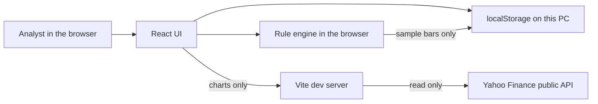
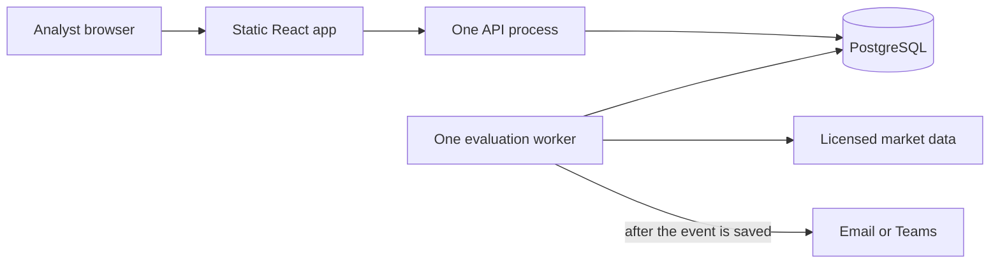
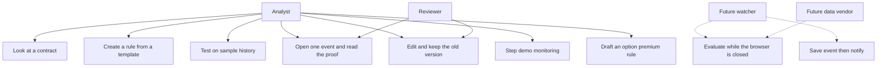

# Algo-Triggers study book

Written 21 October 2026 for an IT graduate on a commodity desk. No futures, options, or Greeks background assumed. Everything below is taken from this repository: the requirements, the running app, and the tests. It is a product explanation, not trading advice and not a claim that the demo watches ICE.

Read **Parts 1–3 and Part 13** before the manager presentation. The rest is the book you keep.

---

## Part 1. Rating

**6.5 / 10 as the department system. 8 / 10 as a Friday demo. 3 / 10 as a live alert service.**

| Lens | Score | What that means |
|---|---|---|
| Honesty | 9 | The app says when a number is a sample, a Yahoo snapshot, or simply unavailable. It does not invent a price to fill a hole. |
| Simplicity of the main job | 7 | A price alert can be made from three templates. Options, the curve, and Greeks are still a second lesson. |
| Rule engine, inside the demo | 8 | Crossings, percent moves, moving averages, cooldown, and “do not rewrite old results” are real code with tests. |
| Notes already in the repo | 8 | The requirements file is unusually clear. It did not teach the finance words. This book does that. |
| Code shape | 6 | Small typed modules for rules and market data. The main screen file is very large, which is fine for a demo and awkward for a team later. |
| Ready for traders to rely on | 3 | Rules live in this browser. Closing the laptop stops watching. There is no shared database, no licensed ICE feed, and no order button. |
| Ready to present | 8 | This machine already has Node.js 24.19.0, the version the project was verified with. Demo samples do not need Yahoo to be up. |

**Judgement.** This is a strong teaching desk and a solid base for the real system. Present it as “the workflow we will operationalise,” not as “production alerting.” The team’s own requirements say the same thing: a demo must never be reported as the monitoring release.

**What is good enough to keep**

- Three rooms: chart, rules, options.
- Plain-English summary before save.
- Every alert keeps the rule version and the numbers that made it true.
- Editing creates a new version. Old test reports stay frozen.
- Yahoo is for looking. Rule tests stay on the sample set, so a pretty live chart cannot silently change an old test.

**What blocks “users use it soon” as a shared desk**

- One browser only. A colleague on another PC does not see your rules.
- Watching is manual: Start demo monitoring, then Advance demo bar.
- Official Brent and official option history are not connected.
- Greeks on the Yahoo path are blank until the desk agrees a pricing model.

**Simplest path for users.** Do not add features before Friday. The simple product is already the first journey: pick the contract on the chart, create a price rule, read the sentence, run the test, open one event. Hide the options room unless someone asks.

---

## Part 2. What this system is

Algo-Triggers is a no-code research terminal for Brent. A person who does not program should be able to:

1. See a price.
2. Write a precise alert rule.
3. Test that rule on past bars.
4. Open the proof for one alert.
5. Later, watch for new alerts.

It does **not** send orders, connect a brokerage account, or tell you whether the alert made money. Alert count is not profit. That omission is a product rule, written in the requirements, because “it fired 12 times” is not “we would have made money.”

### The three rooms

| Room | Job | What a new user should do there |
|---|---|---|
| Market Explorer | Candles, moving averages, the futures curve | Look, then click Create rule |
| Rules & Alerts | Build, save, test, inspect, step a demo watch | The presentation lives here |
| Options Lab | Option prices, a simple strategy, a volatility picture | Only if the manager asks about options |

There is also an event history view so you can reopen proof after a refresh.

### Two number sources, and they do not mix

| Source | What it is | Used for alerts? |
|---|---|---|
| Demo samples | A fixed fake week of prices, 12–16 October 2026. Same bars every time. | Yes. Every rule test and every demo watch uses this set. |
| Yahoo snapshots | Public quotes fetched through a small local API. Delay is unverified. | No. Looking only. If Yahoo fails, the screen says unavailable. It does not swap in fake bars. |

Say this sentence in the room: **“The chart can show Yahoo. The alert test always names the sample dataset.”**

### What “done” means in the requirements

The requirements split the product into releases. Only the first one exists.

| Release | Meaning | Status in this repo |
|---|---|---|
| Demo | Clickable frontend, sample data, real calculations on those samples | Built |
| Research | Shared server storage and replay on entitled history | Not built |
| Monitoring | A process that keeps running, stores events, then sends a notification | Not built. The demo watch stops when the browser closes. |
| Options completion | Licensed option history and an agreed Greek model | Not built. The screen can draft a premium rule. It will not invent option history. |

---

## Part 3. Commodity words, slowly

You do not need to become a trader this week. You need to recognise the nouns on the screen.

### Oil and Brent

A **commodity** is a bulk good: oil, gas, metals, grain. This desk’s example is crude oil.

**Brent** is a North Sea crude benchmark. People quote “Brent” the way people quote a stock index: it is the reference price everyone argues about. It is not one physical barrel on your desk.

**USD/bbl** means US dollars per barrel. Futures prices in this app use that unit. Oil-fund options from Yahoo use **USD/share**, because those are fund shares, not barrels. If the unit changes, say so. Never treat them as the same number.

### Futures

A **futures contract** is an agreement to buy or sell later, at a price set now, on an exchange. You do not pick “oil” in general. You pick a month.

**Brent · Dec 2026** means the December 2026 contract. January 2027 and February 2027 are different contracts with different prices. This demo only offers those three specific months. It does not silently roll you into the next month. That is deliberate. Rolling has rules the team has not agreed yet, and a bad roll can create a fake price jump that looks like an alert.

**Expiry** is the date that contract stops. After expiry you cannot keep using the old month as if it were still listed.

**Front month** means “whichever contract is the nearest active one.” A **continuous series** stitches many months into one long line. Both can create fake signals if the stitch method is sloppy. The requirements say: specific contracts first. This demo follows that.

### A candle

A **bar** (candle) is one time bucket:

- **Open** — first price in the bucket
- **High** — highest
- **Low** — lowest
- **Close** — last price in the bucket
- **Volume** — how much traded, if we know. Unknown stays blank, never zero.

**5m / 15m / 1h** are the bucket sizes. The engine scores a bar only after it has **closed**. It will not pretend an unfinished candle already has its final high and low. That rule is called closed-bar evaluation. It keeps the proof honest.

Times are stored in UTC. A local-time label is only a display choice. The app does not invent the exchange’s trading-session calendar.

### The curve and the spread

The **futures curve** is a plot of several contract months at one moment.

A **calendar spread** here is a signed subtraction:

`near month price − far month price`

Both contracts and both quote times stay visible. The app does not replace that pair with one mystery number.

- Result **positive**: near is richer than far. For that pair the app calls this **backwardation**.
- Result **negative**: far is richer than near. The app calls this **contango**.
- A curve can be mixed. Do not stamp one word on the whole curve.

“The spread widens” is a bad alert sentence. Wider could mean more positive or more negative. The product asks you to say “increases” or “decreases” on the signed number, or to talk about the absolute size. The demo does not turn that sentence into a live spread rule yet.

### Moving averages

**SMA(N)** is the simple average of the last N closed bars, including the current one. SMA(20) on 5-minute bars is 20 bars, not 20 calendar days.

**EMA(N)** is an average that weights recent bars more. It needs a warm-up: no value exists until enough bars have arrived. The chart and the rule engine must use the same values. Tests check that.

There is no alert from an average that has not warmed up. Missing is **unknown**, not zero.

---

## Part 4. Options and Greeks without the fog

Skip this part in the presentation unless someone asks. Learn it so you are not stuck if they do.

### The ticket, not the oil

An **option** is a right, not an obligation, and not the oil itself.

| Word | Plain meaning |
|---|---|
| Call | Right to buy at the strike |
| Put | Right to sell at the strike |
| Strike | The price written on the ticket |
| Expiry | The day the ticket dies |
| Premium | The price of the ticket |
| Underlying | The thing the ticket refers to. For a real Brent option that should be a futures contract. For Yahoo BNO/USO it is the fund share. |

The chain layout is the industry picture: **calls on the left, strikes in the middle, puts on the right.**

### Bid, ask, last, mark

| Field | Meaning | Trap |
|---|---|---|
| Bid | Best price a buyer is offering | Can be missing |
| Ask | Best price a seller wants | Can be missing |
| Last | Last traded premium | A last-price rule must not quietly switch to bid |
| Mark / midpoint | `(bid + ask) / 2` | Only if both sides exist and ask is at least bid. Otherwise unavailable |

Crossed quotes (ask below bid) are not a valid ordinary midpoint.

### Long, short, debit, credit

**Long** means you bought. Quantity is positive. **Short** means you sold. Quantity is negative.

In this app’s proposal, a **positive** strategy premium is a **debit** (you pay to put the position on). A **negative** premium is a **credit** (you receive money to put it on). The value of the position later is a different sign story. The screen is supposed to label them separately. Do not say “negative means we lost money.”

### Three structures the screen knows

| Template | What it is | What must be true |
|---|---|---|
| Vanilla | One option leg | Contract, side, strike, expiry, quantity |
| Vertical (put spread in the demo) | Two options, same type, same expiry, different strikes | Invalid shapes are rejected |
| Collar | The underlying exposure, plus a put and a call | The underlying is shown on its own. A barrel in a tank and a futures position are not assumed to be the same thing |

There is **no** “strategy IV” made by averaging the legs’ IVs. An alert must name one leg, or a measure the team has defined on purpose.

### Greeks

Greeks are slopes. They answer “if this input moves, how does the option price move?” They are not quotes you observed on the tape. A model output must never be shown as if the exchange printed it.

| Greek | Question it answers | Beginner picture |
|---|---|---|
| Delta | If the underlying price moves by 1, how much does the option price move? | Call delta is often 0 to 1. Put delta is often −1 to 0. Deep in-the-money calls behave a bit like the underlying. |
| Gamma | How fast does delta change? | Largest when the strike is near the current price. |
| Theta | How much value time eats? | Usually negative for a long option. Always say the time unit, such as per day. |
| Vega | How much the price moves if volatility moves? | Say whether you mean one volatility point or a percent change. |
| IV | Implied volatility | The jumpiness already baked into the premium. 35% IV does not mean “oil will move 35%.” |

**Volatility point vs percent.** IV from 35% to 36% is **+1 volatility point**. The relative change is about +2.9%. “IV jumps 2%” is ambiguous. The requirements force that question into the open. The demo parser refuses option sentences and tells you to set the contract by hand.

**This repo’s rule.** Yahoo Greeks stay unavailable until a verified model exists. The demo option page can show illustrative Greeks so you can learn the layout. Those numbers are not a hedging decision. The multi-expiry 3D surface in demo mode is a picture. A smooth fill between points is for looking. Alerts do not use the fill. A missing IV is a hole, not zero.

### BNO and USO, say this if asked

BNO and USO are US oil **funds**. Their options are priced in dollars per share. They are not ICE Brent futures options. The app labels them that way on purpose. December Brent futures must not be replaced by a generic `BZ=F` symbol. The Yahoo adapter asks for the listed symbol, for example `BZZ26.NYM` for December 2026, and shows unavailable if that symbol is missing.

---

## Part 5. How a rule thinks

This is the heart of the system. If you understand this part, you understand the product.

### A rule is a form, not a chat that trades

You may type a sentence. The parser only accepts a few shapes, such as “crosses above 82.50” or “SMA(20) crosses above SMA(50).” It fills the form. You read the form. You save. Nothing runs as code you typed. There is no `eval`. Unsupported sentences stay as an explanation, not as a guessed rule.

Sentences that must be clarified, not guessed:

- “Brent rises 2%” — from which price, over how long?
- “Alert on the 20/50 crossover” — SMA or EMA, which direction, which timeframe?
- “Put hits $2” — which contract, bid or ask or last, crossing or already above?
- “IV jumps 2%” — points or relative percent?
- “Spread widens” — signed or absolute?

### The comparisons

For a value now `x[t]`, the previous eligible value `x[t-1]`, and a line `y`:

| Operator | True when |
|---|---|
| Above | now is strictly greater than the line |
| Below | now is strictly less than the line |
| Crosses above | previous was on or under the line, and now is over it |
| Crosses below | previous was on or over the line, and now is under it |

Touching the line is not “above.” If there is no previous bar, a cross cannot fire. Display rounding is not the calculation. The engine uses the source numbers.

### Percent

`100 × (current − reference) / reference`

The reference must be chosen and must be positive. Zero or missing reference makes the percent check **unknown**. The app will not divide quietly or jump back to “whatever quote we happen to have.”

“Falls more than 2%” means the change is **less than −2**, not “−2 or worse.” From 100 to 98 is exactly −2%, so a strict “more than 2%” rule does not fire.

### True, false, unknown

Each condition has three answers. **Unknown** means we cannot tell, usually because data is missing, stale, or not warmed up.

| Join | Rule |
|---|---|
| AND | One false makes the group false. If nothing is false, one unknown makes the group unknown. |
| OR | One true makes the group true. If nothing is true, one unknown makes the group unknown. |

Only a **true** group can emit an alert. Unknown does not become true.

The first release allows one AND/OR group, up to three conditions in the demo. Nested groups are rejected, not secretly flattened.

### When it is allowed to speak

The condition can be true for many bars. That is not the same as sending many alerts.

| Policy in the app | Behaviour |
|---|---|
| Once per crossing | Fire when it becomes true. It must go false before it can fire again. |
| Once per bar | At most one alert for that bar. |
| One-shot | Fire once. A new copy or a new version is how you arm it again. |
| Cooldown | Wait the stated minutes after an emitted alert. A suppressed moment does not reset the clock. |

Pause emits nothing. Resume does not replay the alerts you missed while paused. Catch-up would be a separate, labelled historical run. A new activation does not invent a fake previous cross.

### What a test report is allowed to say

| Metric | Meaning |
|---|---|
| Trigger count | Alerts actually emitted, after policy and cooldown |
| Trigger-period percentage | Share of eligible bars that produced an alert |
| Average gap | Average time between alerts. With fewer than two alerts, this is unavailable |
| Distribution | Counts by time bucket, with the timezone stated |

Not in the report: return, drawdown, win rate, profit. Those need trade-simulation assumptions the product does not have.

### Versions and proof

Saving an edit writes a **new immutable version**. Opening an old run shows the old sentence and the old numbers. The event stores the rule version, the time, the contract, and each condition’s actual value, reference, and true/false/unknown.

That is the sentence for your manager: **“We can show why it fired, and a later edit cannot rewrite that proof.”**

The engine id in code is `demo-closed-bars-v1`. Same rule, same sample bars, same engine: same events. Calculations use ordinary JavaScript numbers. A production money engine should use a decimal type and a parity test against this one before anyone calls them equal.

---

## Part 6. Click path you should be able to narrate

This is the user journey the requirements call Journey A. It is also the Friday demo.

1. Open Market Explorer. Source: **Demo samples**. Contract: **Brent · Dec 2026**. Timeframe: **5m**.
2. See candles. Optional: turn on an SMA or EMA. The disclosure shows the method and the periods.
3. Create a rule from the chart, or open Rules and pick a template: **price level**, **percent move**, or **moving-average crossover**.
4. The form is already filled with the contract, the field, and the timeframe. Read the plain-English summary. It includes timeframe, field, frequency, and cooldown.
5. Advanced settings (timeframe, cooldown, extra conditions) stay inside a disclosure. You do not need them for the first demo.
6. Save. The rule is a draft in this browser.
7. Test rule. Pick the sample date range. Run. You see a count, not a profit number.
8. Open one event. The chart and the diagnostics show the bar and each condition.
9. Edit the threshold and save. That is version 2. Open the old report. It still describes version 1.
10. Start demo monitoring. Press **Advance demo bar** once. Explain that this is a manual clock, not a live feed.

Journey B (option premium) can be a backup answer: pick expiry, pick bid or ask or last, create a draft. Historical option replay stays disabled, with a reason. Journey C (spread or strategy) is the same idea: the formula and every leg stay visible. The demo does not yet evaluate spread rules or strategy alerts.

---

## Part 7. What the requirements asked for, and what you can point at

The authority document is `docs/ALGO-TRIGGERS-REQUIREMENTS.md`. Labels inside it matter:

- **Source requirement** — the team’s original brief said this.
- **Proposed specification** — an engineering choice so the brief can be built. The team may change it.
- **Decision needed** — a business or market-data choice. The demo may proceed. The live feature may not.

### Built and safe to show

- Market chart: candles or line, 5m/15m/1h, SMA/EMA, keyboard zoom, table of the same bars, CSV export.
- Three demo contracts and a sample curve with a signed near-minus-far value.
- Rule templates, one AND/OR group, price / percent / SMA / EMA.
- Save, search, duplicate, new version, replay, cancel, event proof.
- Browser storage that survives refresh. A bad stored file is ignored and the demo seeds return.
- Manual demo watch with pause and resume.
- Options chain, strategy legs, projected volatility surface with a table fallback.
- Read-only Yahoo adapter for display, with source, observation time, fetch time, and age.
- Tests: 36 domain tests and 17 browser journeys were recorded as passed on 19 October 2026 with Node 24.19.0. This check is evidence for the demo, not a certificate that Yahoo or ICE is correct.

### Not built, and you should say “not yet”

- Shared database, logins, roles.
- A watcher that runs after the browser closes.
- Email, Teams, or any delivery channel. A failed delivery must never delete the event. That rule exists on paper only.
- Licensed ICE data, front-month roll, continuous series.
- Option-history replay, Greek alerts, surface alerts, calendar-spread alerts.
- Order routing. Out of scope on purpose.
- Full WCAG certification. The tested screens had no axe violations. That is not a complete accessibility sign-off.

### Decisions your manager may own

These are copied from requirements section 14, in desk language.

| Decision | Why you cannot invent it |
|---|---|
| Which data vendor, and what we are allowed to store | Yahoo is a public snapshot. Official alerts need the desk’s entitled feed. |
| Which history exists for futures vs options | No option history means no option replay. |
| Exchange calendar and what a “daily bar” is | Otherwise “20-day average” is undefined. |
| How front-month roll works | A roll can look like a price spike. |
| Which price field is the official one | Bid, ask, last, and mark fire at different times. |
| Which option model and Greek units | Wrong model, wrong delta. |
| How stale a quote may be | Stale inputs should become unknown, not a trigger. |
| Templates only, or a language model later | First demo is templates. A model must not be allowed to place trades or see secrets. |
| Where alerts are delivered | In-app first. |
| Who may log in, and how long we keep events | Needed before more than one person shares the system. |

---

## Part 8. Tech stack

What is installed, from `package.json`, and what the requirements recommend next.

### Running today

| Piece | Choice | Role |
|---|---|---|
| UI | React 19, TypeScript, Vite 7 | The desk in the browser. No server-side rendering. |
| Charts | TradingView Lightweight Charts 5 (Apache-2.0) | Draws candles. It is not a data vendor. Leave its attribution logo on. |
| Icons | lucide-react | Small icons with text on important buttons. |
| Tests | Vitest, Playwright, axe | Formula tests and browser journeys. |
| Market display API | Node HTTP server, `server/index.mjs` | Proxies Yahoo. Loopback only. |
| Rule engine | `src/domain.ts` | Runs in the browser on sample bars. |
| Storage | `localStorage` key `algo-triggers-demo-v1` | This browser only. |
| Language runtime | Node.js 22.12+ | This PC: Node **24.19.0**, npm 11.17.0. |

`npm run dev` starts Vite on `http://127.0.0.1:5173/` and mounts `/api` inside that dev server. `npm run server` is the same API alone on port 3001. A production `vite preview` does **not** include `/api`. For Friday, use `npm run dev` only.

### What not to add before users need it

The requirements mention Python and FastAPI as a **candidate** for a later research service. The working brain is already TypeScript and already tested. Rewriting it in Python this month creates a second engine that can disagree. Keep one engine until a quant library forces a second language. If a second engine appears, it must pass the same fixture tests before anyone calls it equivalent.

Kubernetes, a message bus, and a public website are the wrong size. This is an internal desk tool.

---

## Part 9. Architecture

### Now



The alert path never needs Yahoo. The picture path may.

### Target, smallest system that matches the requirements



Four jobs stay separate, even if one small server runs them at first:

1. **Ingest** market data.
2. **Evaluate** rules.
3. **Store** the event.
4. **Deliver** the notification.

Store the event before you try to deliver it. A failed email must not delete the proof. Closing the browser must not stop operational watching. That is the difference between this demo and the monitoring release.

Proposed API shape, not built yet: instruments, bars, curve, options, surface, rules and versions, backtests, monitors, events. Details are in requirements section 10. Do not describe those URLs as live.

---

## Part 10. Use cases



Solid lines exist in the demo. Dotted lines are the next release. There is no use case for placing an order.

| ID | Actor | Goal | Demo today? |
|---|---|---|---|
| UC1 | Analyst | See Dec 2026 bars, averages, curve | Yes, samples. Yahoo is display-only. |
| UC2 | Analyst | Save a price, percent, or moving-average rule in a few clicks | Yes |
| UC3 | Analyst | Replay a date range and see a count | Yes, sample bars |
| UC4 | Analyst or reviewer | See the bar, the threshold, and true/false/unknown | Yes |
| UC5 | Analyst or reviewer | Change the rule without changing old proof | Yes |
| UC6 | Analyst | Pause, resume, advance one demo bar | Yes, manual |
| UC7 | Analyst | Start from an option row and a chosen price field | Draft only. No option history replay. |
| UC8 | Worker | Keep evaluating on entitled data | No |
| UC9 | Worker | Notify without losing the event | No |

---

## Part 11. Database

### What exists

There is no database. The browser stores one JSON document:

- rules and versions
- test reports
- events (history is capped, on the order of 500 events and 20 reports, with the full result kept inside a retained report)

Another PC, another browser, or a cleared site data store does not have those rules. Two tabs notice a conflict and ask you to reload rather than silently overwriting.

SQLite is acceptable only as a later single-laptop prototype. For a department, use **PostgreSQL**. More than one person will save rules. Versions must be insert-only. Events must survive a restart.

### Tables to add when you leave the laptop

Speak about them as folders, not as jargon.

| Table | Holds | Why it exists |
|---|---|---|
| Instrument | Contract id, exchange id, expiry, currency, unit, what it refers to | “Dec 2026 Brent” must stay a stable id |
| Series definition | Specific contract vs front-month vs continuous, and the roll policy version | So a roll cannot happen invisibly |
| Observation | Price field, event time, receipt time, source, quality | So we can say where a number came from |
| Rule | Name, tags, owner, pointer to the current version | The identity that stays while versions change |
| Rule version | The frozen expression, settings, hash, time | Old proof points here |
| Monitor | Which version is armed, paused or degraded | Watching is not the same as “the rule exists” |
| Backtest run | Dataset, range, engine version, coverage, status | A failed run must not look completed |
| Trigger event | Idempotency key, time, contract, diagnostics, mode | One real alert stored once |
| Delivery attempt | Channel, try number, sent or failed, next retry | Delivery can fail; the event remains |
| Strategy | Signed legs and the underlying exposure | So a spread is not stored as one price |
| Surface snapshot | As-of time, source quotes, what was interpolated | A picture is not an observation |

Statuses stay separate on purpose:

- Rule text: draft, valid, invalid, archived.
- Watching: inactive, monitoring, paused, degraded, disabled.
- A test run: queued, running, completed, failed, canceled.

“We backtested it” is a fact about a version. It is not the same as “it is armed.”

Prices should travel as decimals or strings, not as formatted text like `$82.50`. The illustrative JSON payload is in requirements section 10.

---

## Part 12. Infrastructure that fits this desk

Best does not mean biggest. Best means the smallest stack that can grow into the requirements without a rewrite.

### Friday through the next user trial: your laptop

- Windows PC, Node 24, this repo, Microsoft Edge.
- `npm run dev`, Demo samples, one browser window at 1280px or wider.
- No database, no cloud, no account.
- Internet is optional if you stay on Demo samples. Do that for the presentation.

### First shared desk: one internal server

When a second person must see the same rules:

| Piece | Choice | Reason |
|---|---|---|
| App | The same React build, static files | Already written |
| API and engine | Node, same TypeScript evaluator moved server-side | One language, tests already exist |
| Database | PostgreSQL | Shared, transactional, versions are rows |
| Worker | One process beside the API | Replay and later watching outlive the tab |
| Front door | Caddy or nginx on the office network | Serves the site and proxies `/api` |
| Login | Department accounts before you share | The requirements leave roles open; do not skip auth on a shared box |
| Secrets | Environment variables on the server, not in the React app | The browser must not hold vendor keys |
| Backup | Nightly database dump | Events are the audit |

Docker is optional packaging. It is not the architecture.

Keep the server off the public internet. This tool will hold desk rules and, later, licensed market data.

### Official alerting: add a vendor, not a new product

- Replace Yahoo as the **alert** source with the feed the commodity desk is allowed to use. Keep Yahoo, if you keep it at all, as a labelled unofficial picture.
- Define staleness: a stale input becomes unknown.
- Persist the event, then send mail or a Teams message, with retries.
- Still no order button until someone writes a separate execution project. This requirements set forbids it in the initial product.

### A sentence on cost and risk

The expensive part is not React. It is **entitled market data**, an agreed option model, and someone owning the server. Building Kubernetes first would spend the month on plumbing and still not answer “which Brent contract is official.”

---

## Part 13. Friday presentation

Today is Wednesday 21 October 2026. **This Friday is 23 October. Next Friday is 30 October.** The script is the same. If the meeting is 23 October, rehearse twice and do not open Options Lab. If it is 30 October, use the study plan in Part 14.

Audience: your manager. Your exec asked you to present the system properly. You are the graduate who can run it and explain the boundary. You are not there to pretend you price options.

### Outcome you want

The manager leaves knowing three things:

1. What the user does in two minutes.
2. What is sample data versus a future live feed.
3. Which decisions the desk must make before anyone relies on an alert.

### Room setup, the night before and again that morning

On this PC, from PowerShell:

```powershell
cd C:\Users\soleh\Documents\Codex\2026-10-19\my-team-ask-me-to-help-2\outputs\Algo-Triggers
node -v
npm ci
npm run dev
```

`node -v` should print `v24.19.0` or any Node 22.12+. `npm ci` uses the lockfile. The terminal prints a URL. It is normally:

`http://127.0.0.1:5173/`

Open that exact URL in Edge. Then:

1. Set the source to **Demo samples**. Confirm the chart is Brent Dec 2026.
2. Leave the app on Market Explorer.
3. Zoom the browser so the chart is large. Width at least 1280px.
4. Do not click Reset. Do not clear site data.
5. Check the laptop does not sleep. Plug in power. Turn off notifications.
6. If Yahoo mode is on and the chart errors, switch back to Demo samples. That failure is a talking point, not a crash: missing data stays missing.

`npm run dev` is the presentation command. Do not switch to `npm run preview` in the room. Preview does not serve `/api`. You do not need `/api` if you stay on Demo samples.

If port 5173 is busy, Vite prints another port. Use the printed URL.

If `npm ci` fails because of network, and you already installed dependencies earlier, `npm run dev` may still start. Try that before the meeting day, not in the meeting.

Backup if the laptop misbehaves: screenshots already live in `docs/evidence/`. Talk through those rather than debugging npm in front of the manager.

Optional confidence check, not during the meeting:

```powershell
npm run typecheck
npm test
```

### 12-minute script

| Time | Do | Say |
|---|---|---|
| 0:00 | Title, no chart yet | “This is a no-code desk for Brent alerts. A user writes a rule, tests it on history, and opens the proof. It does not place trades.” |
| 0:40 | Show the three room names | “Chart, rules, options. Today I will only show the path a user finishes in a few clicks.” |
| 1:10 | Point at Demo samples | “These prices are a fixed sample week, so the demo is repeatable. Yahoo can be shown later as a picture. Tests do not follow Yahoo.” |
| 2:00 | Create a price rule from the chart or the price-level template | “The contract and the timeframe come from the chart. The user reads this sentence before saving.” |
| 4:30 | Save, run the test | “The result is how many alerts fired, after cooldown. It is not a profit number.” |
| 6:30 | Open one event | “This is the bar, the threshold, and whether each condition was true, false, or unknown.” |
| 8:15 | Edit and save version 2, then open the old report | “A new version does not rewrite the old proof.” |
| 9:30 | Start demo monitoring, advance one bar | “Watching in this build is a manual clock. When we close the laptop, it stops. A later release needs a server process.” |
| 10:30 | Stop clicking | “Before anyone relies on this, the desk chooses the data vendor, the official price field, and where alerts are delivered. I can list those decisions. I should not guess them.” |

Stop at 12 minutes. Questions use the crib sheet. Do not tour the 3D surface unless they ask. If they ask, say it is a sample picture with a table behind it, and it is not an alert input.

### If they interrupt

| Question | Answer |
|---|---|
| Can we trade from this? | No. Orders are out of the first product on purpose. |
| Is this live Brent? | The demo is sample data. Yahoo mode is a public snapshot, not a licensed ICE feed, and delay is unverified. |
| Why are Greeks blank? | We will not show a model number as if the exchange printed it. The desk still has to choose the model. |
| Why can’t my colleague see my rule? | It is stored in this browser. Shared use needs PostgreSQL and a login. |
| Did we build the whole brief? | We built the demo release. Monitoring, entitled data, and full options are later gates. |
| Is it secure enough to put online? | Not as a public site. Next step is one internal server. |
| What do you need from me? | A vendor decision, a user list, and permission to keep alerts internal. |

### Words to avoid

- “Real-time ICE”
- “Production ready”
- “This alert would have made money”
- “Greeks are calculated” on the Yahoo screen
- “The database” — there isn’t one yet
- “AI places the trade”

---

## Part 14. Study plan

### If the meeting is 23 October

- Tonight: Parts 1, 2, 3, 5, and 13. Run the app once on Demo samples and complete the click path without notes.
- Tomorrow morning: Part 13 again, out loud, timed. Skim Part 4 so Greeks are familiar. Do not add features.

### If the meeting is 30 October

| Day | Read | Do |
|---|---|---|
| 21 Oct | Parts 1–3 | Run the app, click only |
| 22 Oct | Parts 4–5 | Explain a cross and a Greek out loud |
| 23 Oct | Parts 6–7 | Match each screen to a requirement id only if you want; the names matter more than the ids |
| 26 Oct | Parts 8–12 | Draw the two architecture pictures from memory |
| 27–28 Oct | Part 13 | Two full timed rehearsals |
| 29 Oct | Part 15 crib sheet | One clean run, then stop changing the machine |

You are allowed to bring this file. A manager would rather see you check a unit than invent a Greek.

---

## Part 15. Crib sheet

Memorise these and you can survive the room.

1. **Product.** No-code Brent research: write a rule, test it, show the proof. No orders.
2. **User path.** Chart, template, read the sentence, test, open one event.
3. **Data.** Demo samples power alerts. Yahoo is a labelled picture. Missing stays missing.
4. **Units.** Futures are USD per barrel. BNO/USO options are USD per share. They are not ICE futures options.
5. **Cross.** Previous bar on one side of the line, this bar on the other. Equal is not above.
6. **Unknown.** Missing data does not become zero and does not fire.
7. **Versions.** Edit creates version 2. Old proof stays.
8. **Metrics.** Alert counts are not profit.
9. **Watch.** Manual demo clock. Laptop closed means stopped.
10. **Next build.** One internal server, PostgreSQL, the same TypeScript engine, then a licensed feed. Notifications happen after the event is saved.
11. **Your role.** Run it, explain the boundary, collect decisions. Do not invent the vendor, the roll rule, or the option model.
12. **Score you can defend.** Strong demo, early shared system. About 6.5 out of 10 for department use, about 8 out of 10 for this presentation, about 3 out of 10 if someone thinks it is already a live alerting service.

---

## Where the detail lives

| If they ask for the paper | Open |
|---|---|
| Full requirements and acceptance ids | `docs/ALGO-TRIGGERS-REQUIREMENTS.md` |
| What the frontend actually does | `docs/FRONTEND-HANDOFF.md` |
| Yahoo versus samples | `docs/MARKET-DATA-HANDOFF.md` |
| Choices already made | `docs/DECISIONS.md` |
| How to start the app | `README.md` |
| Test evidence | `docs/FRONTEND-VERIFICATION.md` |
| Visual design | `DESIGN.md` |
